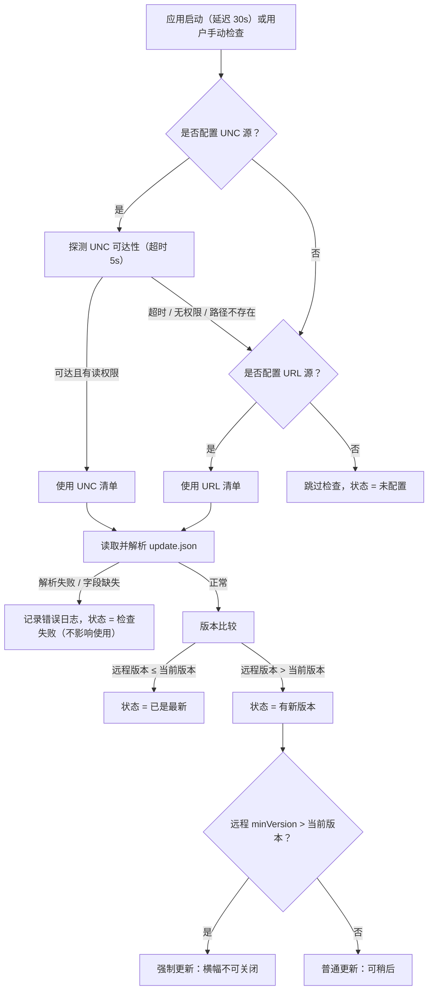
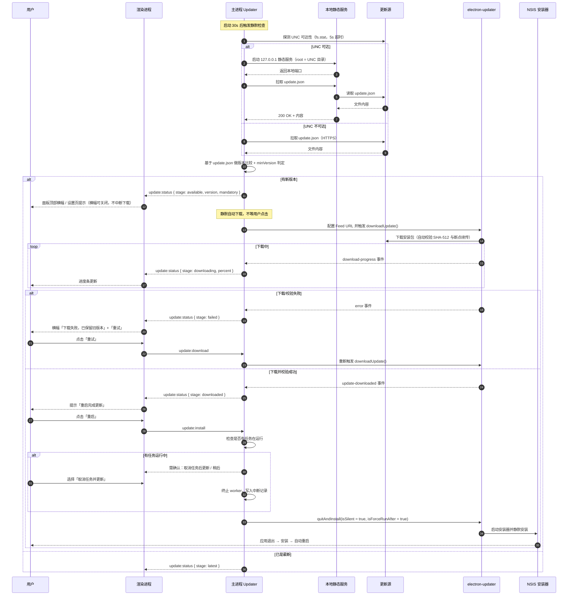
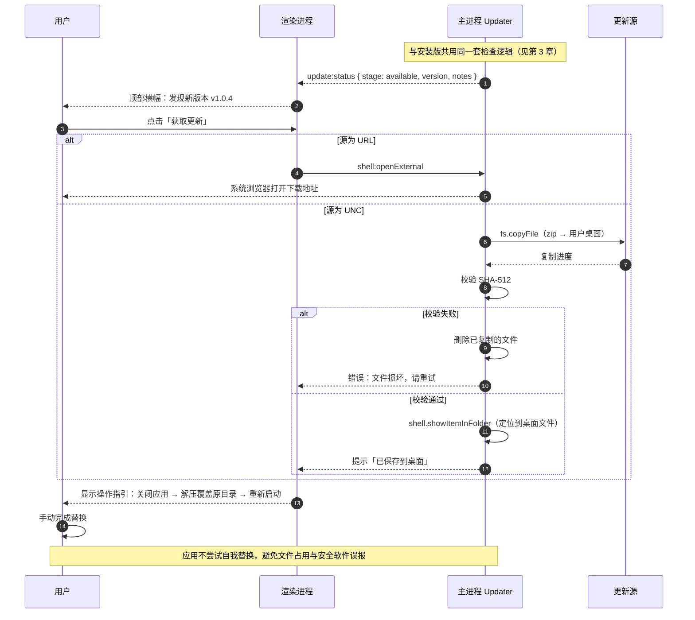

# 打包、分发与自动更新

> 版本：v1.0 ｜ 日期：2026-10-25
> 上游文档：《shx-tools 需求与方案设计（总览）》§4.2、§4.3
> 关联文档：《shx-tools 架构设计与技术栈》§9（`update:*` 通道）、§14.5（打包参数）；《shx-tools UI 设计规范》§4.5（设置页）
>
> 本文承接总览 §4.3 原先的实现细节：发布产物、更新源字段、降级路径、两种通道的时序与异常矩阵。**要求本身仍在总览 §4.3**，本文只描述方案。

## 0. 本文范围

覆盖：发布产物与更新清单格式、更新源配置、源选择与降级、NSIS 通道时序、ZIP 通道时序、异常路径矩阵、免安装版的未来演进。

不覆盖：打包参数与构建配置（《架构》§14.5）、更新相关 IPC 与状态机（《架构》§9）、设置页控件与文案（《UI》§4.5）。

---

## 1. 双通道与发布产物

**核心事实**：`electron-updater` 官方只支持 NSIS / DMG / AppImage 等目标，**ZIP 与 portable 不生成 `latest.yml`，无法走官方更新链路**。因此两种形态必须分开设计。

**发布产物清单**（同一份版本元数据生成，避免两处不一致）

| 文件            | 使用方                   | 说明                         |
| ------------- | --------------------- | -------------------------- |
| `latest.yml`  | 安装版（electron-updater） | 由 electron-builder 生成，不能手改 |
| `update.json` | 免安装版 + 人工核对 + 源健康探针   | 自研格式，见下文「更新清单格式」           |

**安全约束**

- HTTPS 源强制 TLS，不接受明文 `http://`，避免更新包在传输中被替换
- 自签证书必须显式开启，开启后在设置页常驻一条警示文字
- 无论源是否可信，更新包一律校验 SHA-512，校验失败即删除
- 源地址变更写入日志（旧值、新值、时间、操作来源），排查"为什么没更新"时这是第一手证据

**通道 A：安装版（NSIS）**

- 用 `electron-updater`，provider 设为 `generic`，feed URL 由第 2 章的配置推导
- UNC 源的处理：主进程启动时拉起一个极简静态 HTTP 服务（`node:http`，监听 `127.0.0.1` 随机端口，根目录指向 UNC 路径，仅允许 `latest.yml` 与 `*.exe`），把该本地地址作为 feed URL 交给 updater
- 这样做的原因：updater 的下载器只认 HTTP(S)，不能直接读 `file://` 或 UNC；用本地回环代理是最小改动的解法，且顺带解决了 UNC 需要凭据透传的问题
- 流程：启动后 30 秒静默检查 → 有更新则后台下载 → 下载完成提示"重启以更新" → `quitAndInstall`
- 支持 `minVersion`：低于该版本强制更新，不可跳过

**通道 B：免安装版（ZIP）—— 只做「检查 + 提示下载」**

已确认不做版本并存与自动替换，逻辑收敛为四步：

1. 启动后按同一清单源（UNC 优先、URL 回退）检查版本
2. 有新版本时，在面板顶部横幅与设置页提示版本号与更新说明
3. 「下载」按钮：URL 源走 `shell.openExternal` 打开下载地址；UNC 源用 `fs.copyFile` 把 zip 复制到用户桌面并 `shell.showItemInFolder` 定位
4. 提示"关闭应用后解压覆盖原目录"，附一句注意事项即可

**为什么不自动替换**：ZIP 形态下应用无法安全替换正在运行的自身 exe。绕过方式（外部脚本延时覆盖）容易触发安全软件，在无代码签名的前提下误报概率进一步放大；启动器的回滚、断电、半包等异常路径，单人维护成本也不划算。等真有人抱怨"每次都要手动下"再升级。

保留的演进路径见附录 A。

**更新清单格式（自研部分统一）**

```json
{
  "version": "1.0.3",
  "minVersion": "1.0.0",
  "releaseDate": "2026-10-23",
  "notes": "修复 UNC 路径扫描卡顿",
  "mandatory": false,
  "nsis": { "file": "shx-tools-Setup-1.0.3.exe", "sha512": "...", "size": 89234123 },
  "zip":  { "file": "shx-tools-1.0.3-win-x64.zip", "sha512": "...", "size": 94120334 }
}
```

## 2. 更新源配置（本地可配）

更新源不硬编码、不打进安装包，全部通过本地配置决定，改完即生效。

**配置项**（设置页「更新」分组）

| 配置项       | 类型     | 校验规则                                                                   | 默认  |
| --------- | ------ | ---------------------------------------------------------------------- | --- |
| 启用自动检查    | 开关     | —                                                                      | 开   |
| UNC 更新源   | 文本     | 以 `\\` 开头，形如 `\\server\share\path`；也接受已映射的盘符路径 `Z:\tools\...`；留空 = 不启用 | 空   |
| HTTPS 更新源 | 文本     | 必须以 `https://` 开头，允许自定义端口与子路径；**拒绝 `http://`**；留空 = 不启用                | 空   |
| 检查时机      | 单选     | 启动时 / 每日一次 / 每周一次 / 仅手动                                                | 启动时 |
| 允许自签证书    | 开关（高级） | 仅内部 HTTPS 使用自签证书时开启                                                    | 关   |

**优先级**：UNC 优先 → HTTPS 回退。两者都填时，每次检查先探 UNC（5 秒超时），不可达或清单读取失败才走 HTTPS；两者都空时状态为「未配置」，静默跳过，不报错。

**生效时机**：保存即生效，无需重启。切换源不清空已下载的更新包，但会重新核对校验值。

**测试连接**（每个源后置一个「测试」按钮）

| 源类型   | 探测方式                       | 成功反馈               | 失败反馈                         |
| ----- | -------------------------- | ------------------ | ---------------------------- |
| UNC   | `fs.stat(<源>/update.json)` | 耗时 + 文件大小 + 清单版本号  | 路径不存在 / 无访问权限 / 超时（>5s）      |
| HTTPS | `HEAD <源>/update.json`     | 状态码 + 证书主体 + 清单版本号 | 404 / 证书不受信任 / TLS 握手失败 / 超时 |

失败时给具体原因，不给"连接失败"这种无从下手的提示。证书错误时附一句"若为内部自签证书，可在高级设置中允许"。

**落盘位置**：`update.*` 六个字段写在 `%APPDATA%/shx-tools/config.json` 的 `update` 段。**完整字段结构由《架构》§10 定义**，本文只规定字段语义与校验规则，不重复维护第二份 JSON 样例。

**默认值注入**：构建时通过环境变量生成 `build-config.json` 一并打包；首次启动合并进用户配置，之后不再覆盖。这样升级安装包不会重置用户已经改过的源。

**锁定模式（locked）**：打包时可选开启。开启后两个源字段在界面上只读置灰，值只能来自安装包携带的 `build-config.json`。用途是统一管控更新通道，防止有人把源改成外网地址。默认关闭——内部工具更需要"源挂了能当场改"的自救能力。

## 3. 源选择与降级



**降级原则**：任一源失败都不阻塞应用启动，也不弹错误弹窗，只在设置页留一行状态文字。内部工具的更新失败不值得打断用户手上正在做的事。

## 4. 安装版（NSIS）更新时序



## 5. 免安装版（ZIP）更新时序



## 6. 异常路径矩阵

| 异常场景             | 检测点                    | 处理策略                       | 用户可见反馈                    |
| ---------------- | ---------------------- | -------------------------- | ------------------------- |
| UNC 不可达 / 无权限    | 检查前 `fs.stat` 探测，5s 超时 | 回退 URL 源                   | 仅设置页显示"UNC 不可达，已切换备用源"    |
| 两个源都失败           | 源选择结束                  | 放弃本次检查，写日志                 | 设置页一行灰字"检查失败，可稍后重试"，不弹窗   |
| 清单 JSON 损坏 / 缺字段 | 解析后 zod 校验             | 丢弃本次结果                     | 同"检查失败"，日志记录具体字段          |
| 版本号格式非法          | 版本比较前                  | 跳过该版本                      | 视为检查失败，不提示更新              |
| 低于 minVersion    | 版本比较后                  | 强制更新，横幅不可关闭                | 全屏遮罩 + "必须更新后才能继续使用"      |
| 磁盘空间不足           | 下载前预检                  | 不开始下载                      | "需要 120 MB 空间，当前可用 80 MB" |
| 下载中断             | 传输层异常                  | HTTP 走 Range 续传，UNC 重试 2 次 | 进度条显示"重试中 (1/2)"          |
| 包校验失败            | SHA-512 比对             | 删除临时文件，终止                  | "安装包校验失败，已删除，请重新下载"       |
| 安装时任务仍在运行        | `quitAndInstall` 前     | 询问用户，确认后终止 worker          | 二选一弹窗，默认"稍后"              |
| 安装程序被杀软拦截        | 无法主动检测                 | 启动后比对版本号                   | 若版本未变，提示"更新未生效，请手动下载安装"   |
| 用户拒绝重启           | 提示后                    | 下次启动再提示，累计 3 次后强提示         | 横幅常驻，不再弹窗                 |
| 便携版替换时文件被占用      | 用户操作阶段                 | 无法检测                       | 指引中明确"请先完全退出应用"           |
| 系统时间异常导致版本误判     | 版本比较仅用语义化版本号，不依赖时间     | 不受影响                       | —                         |

> 设计原则：**更新失败永远不能影响应用可用性**。除"低于 minVersion"外，所有异常都不阻断主流程；除"强制更新"外，所有提示都可关闭。

---

## 附录 A：免安装版更新演进路径（暂不实施）

若后续要对 ZIP 版本做自动更新，推荐「版本目录 + 启动器切换」：

```
shx-tools/
├─ shx-tools.exe          # 启动器（约 2 MB，长期稳定，极少更新）
├─ current.json           # { "version": "1.0.3", "previous": "1.0.2" }
├─ versions/1.0.3/        # 完整应用
└─ downloads/             # 更新包缓存
```

启动器读 `current.json` 拉起对应版本；下载 → 校验 SHA-512 → 解压到 `versions/<new>/` → 原子写 `current.json` → 重启；新版本连续启动失败 2 次自动回滚到 `previous`。启动器本身需保持极简，因为它无法自我更新。
