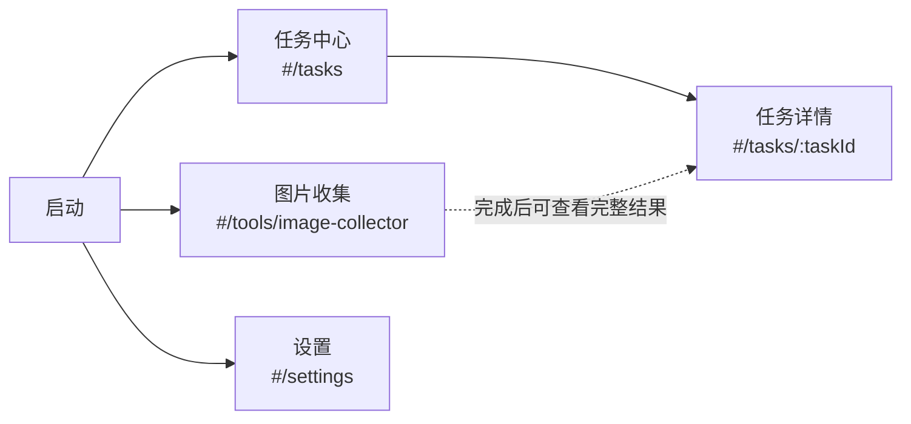
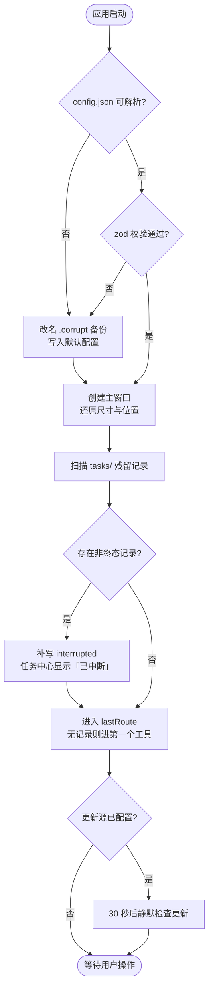
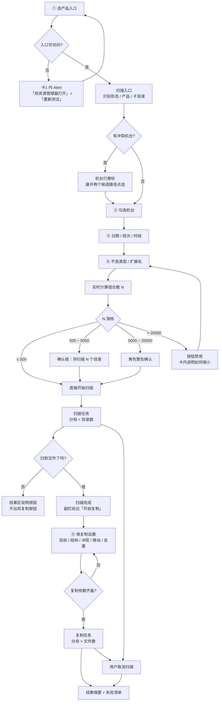
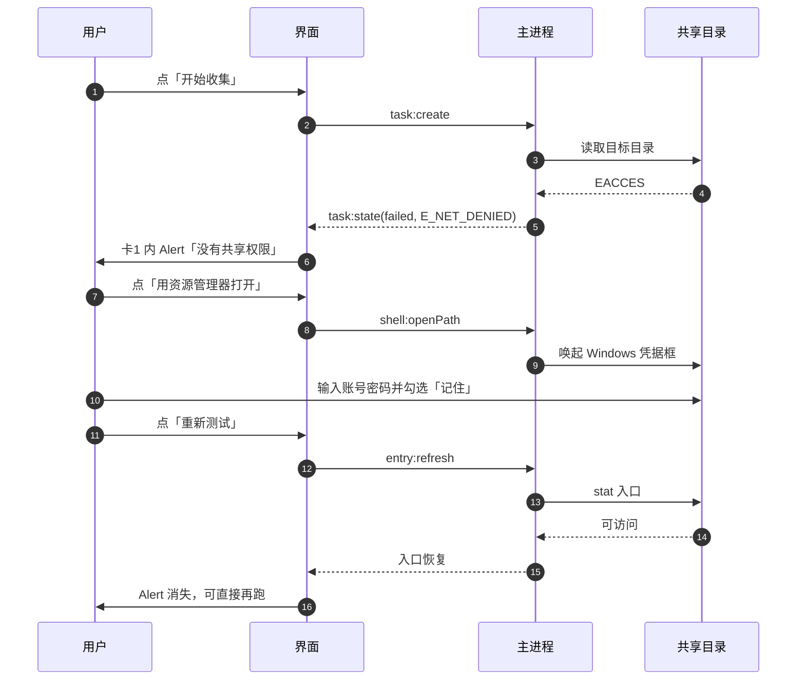
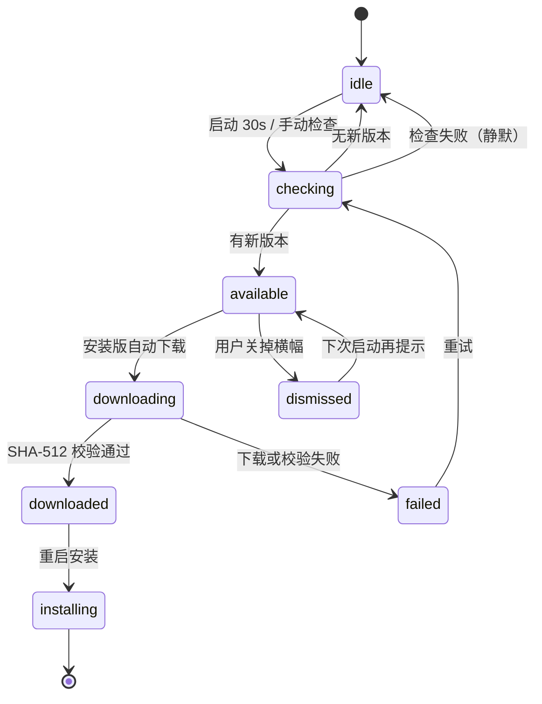

# shx-tools UI 设计规范

> 版本：v0.1（草案，待评审）｜ 日期：2026-10-24
> 上游文档：《shx-tools 需求与方案设计（总览）》
> 关联文档：《shx-tools 架构设计与技术栈》《shx-tools F1 图片收集设计》
> 实现基线：Electron 44.9.x · React 19 · Ant Design 6.6.7 · TypeScript 5 strict

---

## 0. 本文范围

覆盖五部分：

1. **交互骨架**（第 1~3 章）：设计原则、信息架构、关键流程
2. **页面规格**（第 4 章）：逐页的布局、区块、交互、数据来源
3. **状态与组件**（第 5~6 章）：状态矩阵、组件选型与用法边界
4. **视觉与文案**（第 7~8 章）：设计令牌、文案规范
5. **落地与验收**（第 9~11 章）：可访问性、实现映射、验收清单

不包含：

- 业务规则本身（路径模板、`.lnk` 解析、去重算法）——见《F1 图片收集设计》
- 进程模型、IPC 契约、存储布局——见《架构设计与技术栈》
- 高保真视觉稿与动效演示。本文给的是**可执行的约束**（令牌、组件、文案），不是像素稿

**读者**：前端实现者、后续接手维护的人、以及评审这份方案的业务同事。

**怎么用这份文档**：写页面前读第 7 章（令牌）和第 6 章（组件边界）；写文案前读第 8 章；提测前对着第 11 章逐条勾。

---

## 1. 设计原则

| 原则 | 具体含义 | 落地检查 |
|---|---|---|
| **任务是一等公民** | 界面的主线是"配置一个任务 → 看它跑 → 看结果"，不是一个功能菜单树。所有页面都能回答"现在有没有任务在跑" | 每页都能看到运行中任务的入口或状态 |
| **状态必须可见** | 任何一个"没东西"的位置都要说明是哪种没东西：没配、没扫到、扫失败、被过滤、还在加载 | 不存在"空白且无解释"的区域 |
| **故障与正常必须分色** | 六种目录状态里只有 3 种是真故障，另外 3 种是正常现象。把"未排产"画成红色，用户会以为出事了 | 汇总条里只有故障项带颜色 |
| **危险操作显式化** | 移动、覆盖、取消任务，都要先说清后果再动手，且不可撤销的必须写明 | 每个不可逆操作都有确认文案 |
| **非技术同事可用** | 界面不出现错误码、JSON、堆栈。技术细节折叠在"详情"里 | 全页面搜不到 `E_` 开头文字 |
| **密度优先** | 桌面工具，一屏要看到更多。行高、间距按桌面密度给，不按移动端留白 | 1080p 下工具页四张卡一屏可见 |

### 1.1 三条不做

| 不做 | 原因 |
|---|---|
| **不做新手引导弹窗/蒙层导览** | 工具页只有 4 张卡，弹窗会挡住真正要操作的地方。引导用「区块级空状态 + 一行提示」承担，详见 4.6 |
| **不做主题皮肤/自定义主色** | 内部工具，主色是识别信号不是营销位。改色只会让截图和文档对不上 |
| **不做移动端/窄屏适配** | 最小窗口 1080×720，低于此不做布局降级，只保证不崩 |

---

## 2. 信息架构

### 2.1 结构：左侧栏 + 右侧面板

**没有首页。** 启动后直接落在上次停留的功能页上，左侧栏本身就是功能清单。

一个工具、一个任务中心、一个设置页——没有需要聚合的东西。做一个"工具中心"等于每次启动多加一次点击，而那张卡片网格永远只有 1 张真卡 + 1 张占位卡。

| 路由 | 内容 | 组件 |
|---|---|---|
| `#/` | 重定向：有 `lastRoute` 就去那里，没有就去第一个工具 | `router.tsx` |
| `#/tools/:toolId` | 工具页 | `pages/tool/ToolPage.tsx`（F1 用 `custom/ImageCollectorForm.tsx`） |
| `#/tasks` | 任务中心 | `pages/task/TaskListPage.tsx` |
| `#/tasks/:taskId` | 任务详情 | `pages/task/TaskDetailPage.tsx` |
| `#/settings` | 设置 | `pages/settings/SettingsPage.tsx`（`?tab=general\|update\|about`） |

Hash 模式（打包后 `file://` 加载，History 模式会 404）。



三条入口平级，谁都不许再挂一层中转页。

**侧栏结构**（三项，不做分组标题——三个条目还分组是过度设计）

| 位置 | 内容 | 说明 |
|---|---|---|
| 顶部 | 应用名 + 版本号 | 高 48px，不折叠时显示文字 |
| 第 1 项 | 图片收集（未来 N 项） | 由 `tool:list` 生成，新增工具自动多一行 |
| 第 2 项 | 任务中心 + 运行中徽标 | 徽标是 `Badge` 数字，0 时不显示 |
| 底部 | 设置 | 吸底，低频入口 |

**工具仍然靠静态注册**：`tools/index.ts` 里加一条，侧栏自动多一行，不改导航代码。这是"新增工具 ≤ 1 天、不动框架"那条能力的落点——只不过它从"往卡片网格里加一张卡"变成了"往侧栏加一行"，工作量更小。

**导航形态：左侧固定导航栏**，理由三条：

1. 任务中心要常驻"运行中 N"徽标，顶部 Tab 塞徽标会把标题挤歪
2. 底部要放设置与版本提示，顶部没地方
3. 工具数量会增长，纵向列表比横向 Tab 更能扩

宽度 200px，可手动折叠到 64px（只留图标），折叠状态写进 `config.json`。

### 2.2 全局布局

```
┌──────────────────┬────────────────────────────────────────────────────┐
│ shx-tools  v1.2  │  图片收集                              [更新] [⋯]  │ 48px
├──────────────────┼────────────────────────────────────────────────────┤
│ ● 图片收集        │                                                    │
│                  │  Content  padding 24px  max-width 1440px  纵向滚动  │
│ ○ 任务中心 ②      │                                                    │
│                  │  ┌──────────────────────────┬────────────────┐    │
│                  │  │  主栏 Col span=16        │  副栏 span=8   │    │
│                  │  │                          │  sticky        │    │
│                  │  └──────────────────────────┴────────────────┘    │
│                  │                                                    │
├──────────────────┤                                                    │
│ ⚙ 设置            │                                                    │
└──────────────────┴────────────────────────────────────────────────────┘
     Sider 200px                        右侧面板
```

| 区域 | 尺寸 | 规则 |
|---|---|---|
| Sider | 200px（折叠 64px） | 固定不滚动；设置吸底 |
| Header | 高 48px | 左侧是**当前功能名**（不是面包屑），右侧放更新徽标与更多菜单 |
| Content | `padding: 24px`，`max-width: 1440px` 居中 | 超宽屏不留白到边上，避免表格被拉到 2400px 宽 |
| 窗口 | 默认 1280×840，最小 1080×720 | 尺寸与最大化状态记忆，启动时按当前显示器夹取 |

**Header 不用面包屑**：层级只有两层（侧栏 → 面板），面包屑会把"图片收集"写两遍。标题在这里的作用是让用户确认"我现在在哪"，不是导航。

**为什么 `max-width: 1440`**：4K 屏上让表单横跨 3000px 会让"标签—控件"的视线距离过长，读一行要转头。超过 1440 后居中留白。

**启动行为**：读 `config.json.lastRoute` 恢复上次页面；没有记录或路由失效 → 第一个工具（图片收集）。

### 2.3 导航规则

| 规则 | 说明 |
|---|---|
| 一次点击可达 | 任何功能都在侧栏一级，不需要先回某个首页 |
| 高亮跟随路由 | 子路由高亮父项（`#/tasks/:taskId` 时「任务中心」保持选中），避免侧栏"什么都没选" |
| 返回路径恒定 | 任务详情的返回目标是任务中心，不回工具页 |
| 深链可用 | 复制 URL 能定位到具体任务；直接粘到地址栏也能打开 |
| 失效深链 | 任务记录已被清理时，详情页显示「任务不存在」+ 回任务中心，不白屏 |
| 离开保护 | 工具页有未开始但已改动的参数时，切走不拦截（参数自动存草稿），只有"任务运行中"才提示 |

**运行中的人机约定**：任务在跑时，用户可以自由切页、可以继续看历史任务、可以取消。**只有 Modal 会阻断操作**，任何"全屏加载遮罩"都不允许出现在本项目里。

---

## 3. 关键流程

### 3.1 启动与恢复



**启动期不打断用户**：除"低于 `minVersion` 的强制更新"以外，任何检查结果都不弹窗通道。检查失败静默，只在设置页留一行状态。

启动到可交互 < 3 秒（SSD）。第一帧先渲染骨架（见 6.11），不等 IPC 返回。

### 3.2 F1 主流程（扫描 → 复制两段）



**入口到出结果，主路径不换页。** 整个作业在工具页上完成，两次任务、五个卡片，中间不跳任何页面。右侧摘要栏依次显示：规模预估 → 扫描进度 → 待复制 → 复制进度 → 结果摘要。理由见 4.2.1。

**扫描完成 ≠ 作业完成。** 扫描任务 `succeeded` 后副栏出现「开始复制」，同时「开始扫描」变成「重新扫描」。用户可以在这里停住——看清了只有 12 个目录有数据，决定不拷了，也是正常收尾。

### 3.3 规模分档的交互细节

| 组合数 | 执行前 | 触发 | 按钮状态 |
|---|---|---|---|
| ≤ 500 | 不打扰，直接跑 | 开始按钮 | 可用 |
| 500 ~ 5000 | `Modal.confirm`：标题「将扫描 1,240 个目录」，正文给耗时预估与可取消说明 | 点开始 | 可用 |
| 5000 ~ 20000 | 同上，但图标用警告色，正文多一句"建议缩小时段或机台范围" | 点开始 | 可用（危险样式） |
| > 20000 | 不弹窗，摘要栏内 `Alert` 说明"超出上限 20,000"并给出三条缩小建议 | 无 | 禁用 + Tooltip 说明原因 |

耗时预估来源：取**最近一次同产品任务**的实测均值（`tasks/*.json` 里有 `elapsedMs` 与目录数），换算成本次；没有历史就显示"暂无历史数据，首次运行后会更准"。**不要**用一个凭空的公式算出"约 3 分钟"——估错了比不估更伤信任。

### 3.4 UNC 权限自愈



**流程设计的要点是"不打断"**：认证必须跳出应用去 Windows 里做（Node 没有 SMB 凭据 API）。所以界面的责任是——把"去认证"这一步变成一次点击，并在用户回来后不用重填任何参数。

`denied` 与 `unreachable` 的提示必须分开：

- `denied` → "没有共享权限" + 去认证的按钮
- `unreachable` → "机台可能关机或断网" + 重试按钮，不提凭据

把两者混成一句"网络错误"，用户会去重装网卡驱动。

### 3.5 冲突机台的确认

`E_LNK_CONFLICT`（快捷方式里 `EnvVar` 与 `PropertyStore` 的主机不一致）不能自动选值。

```
┌─ 机台 6D ─────────────────────────────────────────────┐
│ ⚠ 需要确认                                            │
│ 这个快捷方式里有两个不同的目标地址：                   │
│   ○ \\10.108.8.227      （来自环境变量块）             │
│   ○ \\10.108.229.131    （来自属性存储块）             │
│ [使用上面这个]  [跳过这台机]                           │
└───────────────────────────────────────────────────────┘
```

- 行内展开，不用 Modal（Modal 会把整张机台表挡住，用户失去上下文）
- 选择结果写回 `categories.json` 的机台缓存，**下次不再问**
- 跳过不阻断其他机台，汇总里计为 1 台跳过

### 3.6 更新流程



| 场景 | 载体 | 阻断 |
|---|---|---|
| 有新版本（安装版） | Header 右侧 `Badge` + 面板顶部横幅 | 否 |
| 下载中 | 横幅内 `Progress`（百分比） | 否 |
| 下载完成 | `notification`：「更新已就绪」+「立即重启」+「稍后」 | 否 |
| 低于 `minVersion` | `Modal`（不可关闭，`closable: false`，无遮罩点击关闭） | **是** |
| 版本未变（安装未生效） | `Modal`：「更新未生效」+ 手动下载指引 | 是（一次性，可关） |
| 免安装版有新版本 | 横幅：「新版本 v1.3.0」+「下载」→ 打开地址或复制 zip 到桌面 | 否 |

**横幅文案分形态**（见 8.4）。免安装版绝不能出现"重启完成更新"这种话——它做不到。

强制更新的 Modal 里要写清为什么强制：`Alert` 一行"当前版本 v1.0.5 低于最低支持版本 v1.1.0，旧版无法读取新的任务记录格式"。不说原因的强制更新会让人以为中病毒了。

---

## 4. 页面规格

### 4.1 应用骨架（侧栏 + 面板）

整个应用只有一个窗口、两个区域：左边是功能清单，右边是当前功能的完整操作面。没有中间层。

```
┌──────────────────┬────────────────────────────────────────────────────┐
│ shx-tools  v1.2  │  图片收集                              [更新] [⋯]  │
├──────────────────┼────────────────────────────────────────────────────┤
│ ● 图片收集        │                                                    │
│                  │   ← 右侧面板：当前功能的全部内容                    │
│ ○ 任务中心 ②      │                                                    │
│                  │                                                    │
│                  │                                                    │
│                  │                                                    │
│                  │                                                    │
│                  │                                                    │
├──────────────────┤                                                    │
│ ⚙ 设置            │                                                    │
└──────────────────┴────────────────────────────────────────────────────┘
```

| 元素 | 规格 |
|---|---|
| 侧栏项 | 高 36px，图标 16 + 文字 14，左内边距 12；选中态 `background: colorPrimaryBg` + 文字 `colorPrimary` + 左侧 2px 竖条 |
| 运行中徽标 | `Badge count`，贴在「任务中心」文字右侧；为 0 时不渲染 |
| 折叠态 | 64px 宽，只留图标，`Tooltip` 补文字；折叠按钮在应用名右侧 |
| 版本号 | 应用名右侧，12px 灰字；折叠后隐藏 |
| Header 右侧 | 「更新」徽标（有新版本才出现）+「⋯」菜单（打开日志目录 / 导出诊断包 / 关于） |

**侧栏由数据生成，不由硬编码**：`tool:list()` 返回几个工具就渲染几行，顺序按注册顺序（不是"最近使用"，那个排序在只有一两个工具时毫无意义）。

**启动就落在工具页**：`lastRoute` 有值且有效 → 去那里；否则 → 第一个工具。用户不需要为"打开软件"这件事多点一次。

**侧栏不折叠也能用**：200px 在 1080 最小窗口下占 18.5%，正文仍有 880px。折叠只是给习惯窄栏的人准备的，不是必需功能。

### 4.2 工具页（F1）`#/tools/image-collector`

#### 4.2.1 布局决策：执行不换页

一屏放两组参数：**①~④ 决定扫什么，⑤ 决定怎么拷**。

```
┌────────────────────────────────────────┬─────────────────────┐
│ 主栏 Col span=16（滚动）                │ 副栏 Col span=8     │
│                                        │ position: sticky    │
│ ┌─ ① 入口与产品 ────────────────────┐  │ top: 80px           │
│ │ 入口路径 [____________] [选择]     │  │                     │
│ │ 利珀 · 快捷方式入口 · 2 个区域      │  │ ┌─ 本次任务 ──────┐ │
│ └───────────────────────────────────┘  │ │ 将扫描  1,240 个 │ │
│ ┌─ ② 机台 ─────────────────────────┐  │ │ 预计    3~8 分钟 │ │
│ │ [东区] [西区]        已选 3 / 46   │  │ │                 │ │
│ │ ☑ A01-A  ☑ A02-A  ☐ A03-A ...      │  │ │ ⚠ 规模偏大      │ │
│ │ [全选] [清空] [搜索____]           │  │ │                 │ │
│ └───────────────────────────────────┘  │ │ [ 开始扫描 ]    │ │
│ ┌─ ③ 时间范围 ─────────────────────┐  │ └─────────────────┘ │
│ │ 日期 [2026-10-23]  班次 (•)白 ( )夜│  │                     │
│ │ 08 09 10 11 12 13 ... 19           │  │                     │
│ │ [全选] [清空]                      │  │                     │
│ └───────────────────────────────────┘  │                     │
│ ┌─ ④ 扫描内容 ─────────────────────┐  │                     │
│ │ 不良类型 [明暗片 ×] [面划伤 ×] [+] │  │                     │
│ │ 扩展名 [jpg] [png] [bmp]           │  │                     │
│ └───────────────────────────────────┘  │                     │
│ ┌─ ⑤ 复制设置 ─────────────────────┐  │                     │
│ │ 目标目录 [E:\collected] [选择]     │  │                     │
│ │ 操作 (•)复制 ( )移动               │  │                     │
│ │ 输出结构 (•)分层 ( )平铺           │  │                     │
│ │ 同名冲突 (•)自动重命名 ( )覆盖 ... │  │                     │
│ │ 内容去重 [ ]                       │  │                     │
│ └───────────────────────────────────┘  │                     │
└────────────────────────────────────────┴─────────────────────┘
```

**为什么 ④ 和 ⑤ 要分开**：它们属于两个不同的任务。④ 的改动会让扫描结果作废（要重扫），⑤ 的改动只影响复制（可以扫完再改、改完再拷）。把两者混在一张卡里，用户会以为改目标目录也要重扫。

| 卡 | 归属 | 改动的后果 |
|---|---|---|
| ① ② ③ ④ | 扫描任务 | 参数快照变化，已扫结果作废；副栏的「开始复制」退回「开始扫描」 |
| ⑤ 复制设置 | 复制任务 | 只影响下一次复制，扫描结果仍然有效 |

**为什么不跳到任务详情页执行**：这个工具的真实使用节奏是"调参数 → 扫 → 看结果 → 拷"。每次开始都跳走，用户要回退一次才能改参数。留在原页，参数还在，改一个数字就能重扫。

副作用是进度面板要在两个地方存在——用同一个 `ProgressPanel` 组件（`compact` 属性区分），不是两套代码。

**执行期主栏让位给明细表**：扫描任务一开跑，主栏的 5 张卡收成顶部一条只读「参数摘要」（单行、点开展开），下面铺开实时明细表——F1 明确要求"看到每个目录扫到了什么"，这条不能在工具页缺失。副栏保留进度、耗时与取消。

**复制任务不占主栏**：复制阶段主栏保持在"扫描明细 + 复制设置"的状态，进度只在副栏显示（分母已从目录数换成文件数，标题会写"复制中"）。扫描明细在复制期间冻结，用户想翻随时能翻。详见 4.2.7。

**窄于 1200px 时**：副栏落到主栏下方，摘要卡变成吸底操作条（`position: sticky; bottom: 0`），保证「开始扫描」/「开始复制」永远可见。

#### 4.2.2 卡 ①：入口与产品

| 元素 | 规格 |
|---|---|
| 入口路径 | `Input` + 右侧「选择」按钮（`fs:pickDirectory`）+「粘贴」图标按钮。支持 UNC（`\\10.108.x.x\share`）与映射盘（`Z:\DC`） |
| 形态徽标 | `Tag`：`快捷方式入口` / `直连入口`，`colorTextSecondary` 描边样式 |
| 产品徽标 | `Tag`：`利珀` / `力禧特` / `EL`。识别失败时变成 `Select`（黄色描边 + Tooltip"没能自动识别，请手动选择"） |
| 摘要行 | 12px 灰色：「2 个区域 · 46 台机台 · 上次刷新 2 小时前」 |
| 刷新 | `Button type="text"` + `ReloadOutlined`，Tooltip「重新扫描机台（Ctrl+R）」 |
| 映射盘提示 | 入口是盘符路径时，路径下方常驻一行 12px 灰字「依赖盘符映射，换电脑可能失效」 |

**输入即扫描**：路径输入框 `onBlur` 或选择器返回后立即调 `entry:scan`，不等用户点"确定"。扫描期间路径框右侧显示 `Spin size="small"`（不换整块骨架，只占位）。

**错误就地显示**：入口不可达时不弹窗，卡 ① 底部出现 `Alert type="error"`，内容是"发生了什么 + 怎么办"（见 8.3）。用户改了路径，Alert 自动消失。

#### 4.2.3 卡 ②：机台

两种入口形态的机台选择器**不一样**，这是本页最容易做错的地方。

| 形态 | 区域控件 | 机台列表 | 跨区 |
|---|---|---|---|
| A（利珀、力禧特） | `Segmented`：东区 / 西区，**单选** | 该区内的 `.lnk` 机台，复选框网格 | 不可跨区（两个区是真实目录，一次任务只扫一个区） |
| B（EL） | `Tabs` 或无控件，用分组标题 | 全部机台，按 `A*` 东区 / `B*` 西区分两组展示 | **可跨区**（区域只是机台名的分组标签，同一个 DC 目录下） |

```
形态 A                              形态 B
┌─────────────────────────┐        ┌─────────────────────────┐
│ ( 东区 ) ( 西区 )   3/23 │        │ 东区 (23)      全选      │
│ ☑ 6B   ☑ 8B   ☐ 9B      │        │ ☑ A01-A ☑ A01-B ☐ A02-A │
│ ☐ 10B  ⚠ 6D(需确认)      │        │ 西区 (23)      全选      │
│ [全选] [清空]  [搜索__]  │        │ ☑ B04-A ☐ B05-A         │
└─────────────────────────┘        └─────────────────────────┘
```

| 元素 | 规格 |
|---|---|
| 机台项 | `Checkbox` + 编码（`6B`、`A01-A`）+ 可选状态点。编码用**自然排序**（`1A < 2A < 10A < LX1`），不做字典序 |
| 网格 | `display: grid`，`grid-template-columns: repeat(auto-fill, minmax(112px, 1fr))`，行高 32 |
| 计数 | 右上角 `已选 3 / 46`，0 选时红色（因为不能开始） |
| 搜索 | 机台数 > 20 才显示搜索框。**过滤时「全选」只作用于过滤结果**，这是最容易误解的一处，所以全选按钮文案随上下文变：过滤时显示「全选这 12 台」 |
| 全选/清空 | `Button type="link" size="small"`，不做成主按钮（避免和"开始"抢主次） |
| 机台状态 | `ok` 正常；`broken` 置灰 + `Tooltip`「快捷方式损坏」且不可勾选；`conflict` 黄标可展开（3.5） |
| 长内容 | 机台编码超长时尾部省略 + `Tooltip` 全称；不做横向滚动 |

**搜索过滤为什么重要**：EL 有 46 台，形态 A 单区 23 台。一屏 5 列 × 5 行，46 台要翻两屏，找 `B04-A` 靠肉眼很累。

#### 4.2.4 卡 ③：时间范围

| 元素 | 规格 |
|---|---|
| 日期 | `DatePicker`（`allowClear=false`，必填）。默认今天 |
| 班次 | `Radio.Group` 按钮样式：白班 / 夜班。默认白班 |
| 时段 | 12 个小时的 `Checkbox` 网格（`grid-template-columns: repeat(12, 1fr)`），**候选集随班次变化** |
| 快选 | 「到当前小时」「全选」「清空」三个 `Button type="link"` |
| 联动规则 | 切班次 → **清空并按新班次重置默认**。不做"保留交集"（会拼出 `白班\0` 这种不存在的目录） |
| 空时段 | 0 个勾选时不能开始，卡底一行红字「至少选一个小时」 |

**小时标签的显示形式随产品变化**：

| 产品 | 白班标签 | 夜班标签 |
|---|---|---|
| 利珀 | `08 09 … 19` | `20 21 22 23 00 … 07` |
| 力禧特 / EL | `8 9 … 19` | `20 21 22 23 0 … 7` |

补零是利珀模板的硬要求（`{hour}` 要 `08` 不是 `8`）。界面上就按最终路径里的样子显示，别让用户猜。括号里不写说明文字，用一个 `Tooltip` 挂在"时段"标签右侧即可。

**默认勾选规则**（对齐 F1 文档 2.2）：班次起点到当前小时；不在所选班次内则一个都不勾。

#### 4.2.5 卡 ④：扫描内容 / 卡 ⑤：复制设置

**卡 ④ 决定扫什么**（改动会让已扫结果作废）

| 元素 | 规格 |
|---|---|
| 不良类型 | `Select mode="tags"`：手输回车即成标签；下拉分组「最近使用」（本产品历史，最多 8 条）+「其他产品历史」。**必填，至少 1 个** |
| 非法字符 | 提交时校验 `\ / : * ? " < > \|` 与 `..`；不合法则拒绝加入并就地红字，不弹窗 |
| 历史删除 | 下拉项 hover 出现删除图标 → `Popconfirm`「从历史中移除？已收集的文件不受影响」 |
| 扩展名 | `Select mode="tags"`，默认 `jpg/png/bmp`，输入自动小写去点 |

**扩展名放在这条卡里，不是复制设置里**：它决定"什么算一张图"，扫描时就已按它筛出文件清单。改它必须重扫，所以它和不良类型挨在一起，视觉上属于同一批"扫描条件"。

**卡 ⑤ 决定怎么拷**（改动只影响下一次复制，扫描结果仍有效）

| 元素 | 规格 |
|---|---|
| 目标目录 | `Input` +「选择」+「打开」图标。默认取上次使用值（全局一份，不按产品分） |
| 操作类型 | `Radio.Group`：复制 / 移动 |
| 移动的警告 | 选「移动」后，单选下方立刻出现 `Alert type="warning"`「源文件会被删除，且取消任务后不恢复」。**在选中的瞬间提示，不等点开始** |
| 输出结构 | `Radio.Group`：分层 / 平铺。切换时下方用 12px 灰字**实时预览一条示例路径** |
| 同名冲突 | `Radio.Group`：自动重命名 / 覆盖 / 跳过。「覆盖」右侧常驻红色小字「不可恢复」 |
| 内容去重 | `Switch` + 右侧说明「同内容只保留一份（较慢）」。「较慢」必须写，否则用户不知道为什么开着去重跑得慢 |

**实时预览示例路径**是本卡最值钱的一个细节：输出结构从"分层"切"平铺"，用户看不出区别，给一条真实路径就懂了。

**卡 ⑤ 在扫描完成前也可以填**，但「开始复制」按钮只有在扫描任务 `succeeded` 后才出现。提前填好的人，扫完就能直接点——不用先扫完再回头配一遍。

#### 4.2.6 副栏：任务摘要（五态）

副栏是整页的"状态机可视面"，形态跟着任务阶段走。**同一时刻只显示一种**。

**① 待开始（扫描预估）**

```
┌─ 本次任务 ────────────────────┐
│ 将扫描                         │
│ 1,240  个目录                  │
│                               │
│ 预计耗时  3~8 分钟             │
│ 来源：最近一次利珀任务的实测    │
│                               │
│ ⚠ 规模偏大，建议缩小时段范围    │
│                               │
│ [    开始扫描    ]             │
└───────────────────────────────┘
```

| 元素 | 规则 |
|---|---|
| 数字 | 24px/600，`font-variant-numeric: tabular-nums`，千分位 |
| 耗时预估 | 14px 次要色；无历史时显示「首次运行，暂无预估」 |
| 分档提示 | 只在 5000~20000 显示一行 `⚠` 提示；<500 不显示任何提示（不打扰） |
| 按钮 | `type="primary" size="large"`，`block`，高 40 |
| 禁用条件 | 按钮禁用并给一行原因：入口未选 / 机台 0 台 / 时段 0 个 / 不良类型 0 个 / 组合数 > 20000 |

**禁用时必须说明原因。** 只用 `disabled` 不给解释，用户会反复点。

**② 扫描中**

```
┌─ 扫描中 ──────────────────────┐
│ 120 / 180 个目录 · 1m20s       │
│ ████████████████░░░░░  67%     │
│ 已发现 4,821 张                │
│ 当前 6B\...\白班\14\A\明暗片    │
│                               │
│ [    取消扫描    ]             │
└───────────────────────────────┘
```

副栏只管"跑到哪了"，逐目录明细在主栏（4.2.7），两边同时存在、互不遮挡。

**③ 扫描完成，待复制** ← 新增的一态

```
┌─ 扫描完成 ────────────────────┐
│ 4,821 张 · 8.2 GB              │
│ 162 个目录有图 · 12 个空        │
│ ⚠ 1 个不可达                    │
│ 耗时 2m10s                     │
│                               │
│ ⚠ 目标只有 3.1 GB 可用          │
│                               │
│ [    开始复制    ]             │
│ 重新扫描  查看完整结果          │
└───────────────────────────────┘
```

| 元素 | 规则 |
|---|---|
| 主按钮 | 「开始复制」，`type="primary" size="large" block` |
| 次操作 | 「重新扫描」（文字按钮，等同改参数重跑）、「查看完整结果」（跳任务详情） |
| 空间预检 | 扫描完立刻算目标盘剩余空间，不够时在按钮上方给一行 `⚠`，**但不禁用按钮**——用户可能正要换个目标目录 |
| 0 文件时 | 不出现「开始复制」，改显示「没扫到任何图片」+ 三个常见原因 + 「重新扫描」 |
| 复制参数未填 | 按钮可用，点了聚焦到卡 ⑤ 的第一个空项并红字提示，不弹窗 |

**这一态是整个作业的决策点。** 前面所有工作的意义就是让人在这里看清"值不值得拷"。所以它不能只是一个 toast，必须占住副栏。

**④ 复制中**

```
┌─ 复制中 ──────────────────────┐
│ 3,200 / 4,821 个文件 · 2m10s   │
│ ████████████░░░░░░░░  66%      │
│ 8.2 / 12.4 GB                  │
│ 当前 IMG_0142.jpg              │
│                               │
│ [    取消复制    ]             │
└───────────────────────────────┘
```

**⑤ 完成 / 失败**

```
┌─ 已完成 ──────────────────────┐        ┌─ 未完成 ──────────────────────┐
│ 收集 4,821 张 · 8.2 GB · 4m12s │        │ 磁盘空间不够                   │
│ 成功 4,818  跳过 12  失败 3     │        │ 需要 12.4 GB，E: 只剩 3.1 GB   │
│                               │        │ 已完成 3,200 / 4,821 个文件    │
│ [打开文件夹] [查看完整结果]     │        │ [换保存位置] [查看完整结果]     │
└───────────────────────────────┘        └───────────────────────────────┘
```

失败态给的是**可执行的下一步**（换保存位置），不是"重试"——空间不够重试还是不够。

**⑥ 取消后**（两种任务的文案不同）

| 任务 | 文案 |
|---|---|
| 扫描 | 「扫描已取消 · 扫完 120 / 180 个目录」，副栏回到①态，「开始扫描」可用 |
| 复制 | 「复制已取消 · 完成 3,200 / 4,821」，扫描结果**仍然有效**，副栏回到③态（可直接再复制一次） |

**复制取消后不回①态**——扫描没白做，没必要让人重扫一遍。

#### 4.2.7 主栏：实时明细

扫描任务一开跑，主栏切换成这个形态：

```
┌─ 参数 利珀 · 东区 · 3 台 · 白班 08~14 · 明暗片×2   [展开] ─────────┐
├──────────────────────────────────────────────────────────────────┤
│ #     目录                            状态        图片数    大小  │
│ 121   6B\2026.10.23\白班\14\A\明暗片    ✓ 28 个    28      10.0 MB│
│ 122   6B\2026.10.23\白班\14\B\明暗片    ○ 空目录    0       —     │
│ 123   8B\2026.10.23\白班\14\A\明暗片    ✗ 不存在    —       —     │
│ 124   8B\2026.10.23\白班\14\B\面划伤    ⚠ 不可达    —       —     │
├──────────────────────────────────────────────────────────────────┤
│ 成功 120 · 空 12 · 不存在 5 · 不可达 1 · 无权限 0 · 异常 0        │
└──────────────────────────────────────────────────────────────────┘
```

| 项 | 规格 |
|---|---|
| 表格 | 复用 `PreviewTable`（与任务详情同一组件），列定义见 6.2 |
| 追加 | 新行在底部追加入场，180ms 淡入；**不自动滚动**——用户往上翻时不能把他拽回底部 |
| 渲染上限 | 只渲染最近 200 行；更早的行留在 `.dirs.jsonl`，由「查看完整结果」去详情页翻 |
| 汇总条 | 吸底，六状态计数，**只有故障项上色**（见 6.3）。六项相加恒等于总数——每个目录恰好一个状态 |
| 行数恒定 | 180 个目录就是 180 行，故障项也占一行（标成不可达/不存在），**不删除、不折叠**。用户要的是「哪些有、哪些没有」的全貌 |
| 分母恒定 | 进度 `done/total` 的 total = 目录数，中途不变，因此必然走到 100% |
| 复制任务期间 | 表格**冻结**在扫描结束时的状态，不再更新；副栏切到复制进度。复制的是文件、不是目录，两套行数对不上，混在一张表里只会让人困惑 |
| 完成后 | 表格保留，副栏显示完成态；点「查看完整结果」进任务详情 |
| 扫描取消后 | 表格保留，最后一行之后追加一行灰字「已取消，剩余 N 个目录未扫描」 |
| 计时 | 每行右侧不显示耗时（信息密度不够），耗时只在详情页看 |
| 部分可用 | 单台机 `unreachable` 只影响它自己的行，不阻断后续行 |

**为什么明细必须在工具页而不只在详情页**：扫描要跑几分钟，用户在这几分钟里唯一想看的就是"扫到哪了、有没有东西"。让他点进详情页再回来看进度，是把同一件事拆成两次导航。

**为什么两侧同时存在**：进度（宏观：120/180）和明细（微观：第 121 行是什么）回答的是两个不同问题，塞进一个区域会互相挤。主栏给微观，副栏给宏观。

### 4.3 任务中心 `#/tasks`

```
┌──────────────────────────────────────────────────────────────────────────┐
│ 任务中心                                                    [导出失败清单] │
├──────────────────────────────────────────────────────────────────────────┤
│ [全部 128] [扫描 96] [复制 32]    [运行中 1] [失败 5] [已取消 2]          │
├──────┬──────────┬────────────┬────────────────────┬──────────┬──────────┤
│ 状态 │ 类型      │ 参数摘要    │ 结果                │ 开始时间  │ 耗时     │
├──────┼──────────┼────────────┼────────────────────┼──────────┼──────────┤
│ ⟳ 收集中│ 复制      │ 利珀·东区   │ 3,200 / 4,821 个文件 │ 今天 14:02│ 2m10s   │
│ ✓ 已扫描│ 扫描      │ 利珀·东区   │ 4,821 张 · 8.2 GB   │ 今天 13:58│ 0m42s   │
│ ✓ 已完成│ 复制      │ 利珀·东区   │ 4,818 成功 / 3 失败  │ 今天 13:59│ 4m12s   │
│ ✗ 失败 │ 复制      │ EL·46 台    │ 磁盘空间不足         │ 昨天 22:10│ 0m08s   │
└──────┴──────────┴────────────┴────────────────────┴──────────┴──────────┘
```

| 项 | 规格 |
|---|---|
| 类型列 | `Tag`：扫描用默认灰边（`扫描`），复制用主色边（`复制`）。**这两类任务的价值不对等，视觉上要能一眼分开** |
| 类型筛选 | 第一组 `Segmented`（全部/扫描/复制，带计数）；第二组是状态筛选。两组之间用 16px 间隔分开 |
| 筛选 | 状态 `Segmented` 带计数，计数为 0 的分段**保留**（灰着），不隐藏——数量变化时按钮不移位 |
| 默认排序 | `startedAt` 降序 |
| 分页 | `pageSize: 20`，`showSizeChanger: false` |
| 运行中行 | 状态列是带进度的小圆环 `Progress type="circle" size={16}`，结果列显示实时计数 |
| 结果列 | 扫描：「4,821 张 · 8.2 GB」；复制：「4,818 成功 / 3 失败」。**两类的数字口径不同，列名统一叫「结果」而不是「成功数」** |
| 参数摘要 | 单行省略；扫描格式 `产品·区域·N台·班次·N时段·N缺陷`，复制格式 `扫描 <shortId> · 目标盘` |
| 批量操作 | **不做批量删除**（任务记录是审计线索，删了就没法追） |
| 空状态 | 见 5.2 |

**为什么类型单独一列而不是塞进状态列**：`✓ 已扫描` 和 `✓ 已完成` 都是成功，但对使用者的意义完全不同——前者是"可以拷了"，后者是"已经拷完了"。合成一列读不出这个差别。

**为什么"取消"直接出现在行操作里**：运行中任务最需要的动作就是取消，藏进详情页等于多两次点击。

### 4.4 任务详情 `#/tasks/:taskId`

两类任务共用同一个页面骨架，**Tab 组成不同**。

**扫描任务**

```
┌────────────────────────────────────────────────────────────────┐
│ ← 任务中心                                                      │
│ ✓ 已扫描   扫描任务   2026-10-24 13:58 开始 · 耗时 42s           │
│                              [用这份扫描复制] [重新扫描]         │
├────────────────────────────────────────────────────────────────┤
│ [概览] [目录明细 180] [文件清单 4,821] [日志]                    │
├────────────────────────────────────────────────────────────────┤
│ 4,821 张 · 8.2 GB                                              │
│ 成功 162 · 空 12 · 不存在 5 · 不可达 1 · 无权限 0                │
│                                                                 │
│ 参数                                                            │
│ 入口    D:\桌面\利珀-在线PL                                      │
│ 机台    6B, 8B, 10B      区域 东区     班次 白班                 │
│ 时段    08~14（7 个）     不良类型 明暗片, 面划伤   扩展名 jpg,png  │
└────────────────────────────────────────────────────────────────┘
```

**复制任务**

```
┌────────────────────────────────────────────────────────────────┐
│ ← 任务中心                                                      │
│ ✓ 已完成   复制任务   2026-10-24 14:02 开始 · 耗时 4m12s         │
│ 基于扫描 20261024-1358-c3d4 →                                    │
│                                   [打开输出目录] [再复制一次]     │
├────────────────────────────────────────────────────────────────┤
│ [概览] [日志] [失败项 3]                                         │
├────────────────────────────────────────────────────────────────┤
│ 4,818 成功 · 12 重复跳过 · 3 失败 · 8.2 GB                        │
│                                                                 │
│ 参数                                                            │
│ 源扫描  20261024-1358-c3d4（4,821 张）                           │
│ 目标    E:\collected      结构 分层     冲突 自动重命名           │
│ 操作    复制               去重 关                               │
└────────────────────────────────────────────────────────────────┘
```

| Tab | 扫描任务 | 复制任务 | 数据来源 |
|---|---|---|---|
| **概览** | ✅ | ✅ | `task:get` |
| **目录明细** | ✅ 六状态表格，支持"只看故障" | — | `<taskId>.dirs.jsonl`（见 4.4.1） |
| **文件清单** | ✅ 将复制的文件列表（`src`→`dest`） | — | `<taskId>.files.jsonl`（`task:files`） |
| **日志** | ✅ | ✅ | `task:log` + 日志文件 |
| **失败项** | — | ✅ 失败清单 + 逐条「重试」+「导出 CSV」 | `TaskRecord.failures` |

| 规则 | 说明 |
|---|---|
| Tab 数字徽标 | 只在数量 > 0 时显示，0 不显示 `0` |
| 扫描任务的「用这份扫描复制」 | 跳回工具页并带上 `scanId`，自动切到卡 ⑤，不直接开跑——目标目录还得确认 |
| 复制任务的「再复制一次」 | 同上，带 `scanId` + 上次的复制参数 |
| 源扫描已清理 | 复制任务的"基于扫描 xxx"变成灰色不可点，`Tooltip`「这次扫描的明细已清理」 |

**为什么扫描任务没有「失败项」Tab**：扫描阶段的"失败"是目录级状态（不可达/无权限），已经在目录明细里逐行呈现了。再造一个失败项 Tab 是把同一批数据说两遍。复制任务的失败粒度是文件，和目录状态不是一回事，所以它才需要这个 Tab。

#### 4.4.1 目录明细的数据来源

`ToolResult` 里不含逐目录明细（见架构文档 6 章），但扫描阶段必须把结果留在某处，否则"999 个目录里到底哪个不可达"就查不了。

| 规则 | 说明 |
|---|---|
| 落盘 | 扫描阶段逐行追加到 `%APPDATA%/shx-tools/tasks/<taskId>.dirs.jsonl`，一行一个目录 |
| 渲染 | 页面按 `offset/limit` 读取（IPC `task:dirs`），表格开 `virtual`，一次取 200 行 |
| 上限 | 单任务最多 50,000 行（远超 20,000 组合上限），超出截断并在表头标「已截断」 |
| 清理 | 只保留**最近 50 个任务**的 `.dirs.jsonl`，随 `startedAt` 一起滚动删除；其余任务只有 summary + failures |
| 缺失 | 明细文件不存在时，Tab 显示"该任务的明细已清理，只能查看汇总"，不报错 |

完整规则（写入时机、体积估算、为什么不塞进 `<taskId>.json`）见《架构设计与技术栈》第 10 章「目录明细」。

#### 4.4.2 复用一次作业

三种入口，行为一致：**跳回工具页并回填参数，不直接开跑**。

| 入口 | 回填什么 | 落到哪个按钮 |
|---|---|---|
| 扫描详情「重新扫描」 | 该扫描的全部扫描参数 | 「开始扫描」 |
| 扫描详情「用这份扫描复制」 | 带 `scanId`，副栏直接进③态 | 「开始复制」 |
| 复制详情「再复制一次」 | 带 `scanId` + 上次的复制参数 | 「开始复制」 |

理由是同一份参数再跑一次的意图千差万别：可能只是换个目标目录，可能是改了日期。直接重跑会复制出第二份 8 GB 的图。回填 + 让用户点确认，成本一次点击，收益是避免误操作。

**「用这份扫描复制」不再重扫**，这是拆任务最直接的收益：昨天扫的清单今天还能拿来拷到今天的目标目录，只要明细没被清理。

### 4.5 设置 `#/settings`

三个 Tab：通用 / 更新 / 关于。

#### 通用

| 配置项 | 控件 | 默认 | 说明 |
|---|---|---|---|
| 默认输出目录 | `Input` + 选择 | 空 | 新任务的初始值 |
| 全局并发任务数 | `Slider` 1~4 + 数字 | 2 | >2 时右侧提示「更高并发不会更快，磁盘和网络会互相拖慢」 |
| 单工具并发 | `Slider` 1~2 | 1 | 同上 |
| 日志级别 | `Select` | info | debug / info / warn / error |
| 打开日志目录 | `Button` | — | `shell:openPath` |
| 导出诊断包 | `Button` | — | 成功后 `message` 给出路径 + 「打开所在文件夹」 |
| 数据目录 | 只读文本 + 「打开」 | — | 指向 `%APPDATA%/shx-tools` |

#### 更新

按《需求与方案设计》4.3.1 的五个配置项。每个源后面一个「测试」按钮。

```
UNC 更新源    [\\fileserver\tools\shx-tools\releases        ] [测试]
              ✓ 可用 · 42 ms · update.json 1.2 KB · v1.2.0

HTTPS 更新源  [https://tools.example.com/shx-tools/releases  ] [测试]
              ✗ 证书不受信任。若为内部自签证书，可在高级设置中允许。

检查时机      (•)启动时 ( )每日一次 ( )每周一次 ( )仅手动
允许自签证书   [ ]  ⚠ 仅内部 HTTPS 使用自签证书时开启
```

| 规则 | 说明 |
|---|---|
| 测试中 | 按钮变 `loading`，右侧灰字「正在测试…」，5 秒超时 |
| 测试结果 | 成功：绿字 + 耗时 + 清单版本；失败：红字 + **具体原因**（`路径不存在` / `无访问权限` / `超时` / `404` / `证书不受信任` / `TLS 握手失败`）。绝不出现"连接失败" |
| 证书错误附加 | 红字后跟一句「若为内部自签证书，可在下方开启『允许自签证书』」——把修复路径给到手边 |
| 保存 | 表单底部 `sticky` 保存条，有改动才出现（避免"我没改什么为什么要保存"） |
| 锁定模式 | `locked: true` 时两个源输入框 `disabled`，上方 `Alert type="info"`「更新源由安装包统一配置，不可修改」 |
| 自签证书开启后 | 该行下方常驻 `Alert type="warning"`「已允许自签证书，更新包传输可能被中间人替换」 |

#### 关于

版本号、Electron / Chromium / Node 版本（只读 `Descriptions`）、构建时间、开源许可链接、「检查更新」、「导出诊断包」。

**版本号要能复制**：加一个复制图标。报障时第一句话就是"你什么版本"，让用户手抄 `1.2.0` 很蠢。

### 4.6 首次使用（无任何配置）

不做独立引导页，用**区块级空状态**承担（决策见 1.1）。

| 位置 | 空状态 |
|---|---|
| 工具页卡 ① | 入口为空 → 占位文字「选择或粘贴产品入口路径」，不带按钮 |
| 工具页卡 ② | 「先选一个产品入口」+ 一个「选择入口」按钮 |
| 工具页卡 ③ | 默认值已填（今天 / 白班 / 到当前小时），无空态 |
| 任务中心 | 见 5.2 |
| 设置 · 更新 | 状态标签「未配置」，灰字「未配置更新源，不影响使用」 |

工具页顶部在**第一次启动时**显示一条可关闭的 `Alert`（`closable`，关闭后写 `config.json` 不再出现）：

> **第一次用？** 先选产品入口（比如 `\\10.108.164.2\qj-dc-el\DC`），机台、班次和时段会跟着带出来。 [知道了]

只要一条，不做三步引导。**用户启动后本来就在工具页上，不需要任何"去某某页"的跳转引导**——这也是砍掉首页之后顺带消失的一个问题。

---

## 5. 状态矩阵

### 5.1 状态清单（S1~S11）

不是所有 11 类都适用。桌面离线工具里没有"浏览器断网"，对应的是"共享不可达"；没有"套餐/额度"，对应的是"Windows 共享权限"。

| 编号 | 状态 | 本项目对应 |
|---|---|---|
| S1 | 首次使用 | 无入口、无历史、无任务 |
| S2 | 空（无数据） | 0 台机台、0 个任务、0 条日志 |
| S3 | 空（被筛选/搜索排除） | 机台搜索无结果、任务筛"失败"但为 0 |
| S4 | 加载中 | 入口扫描、任务列表拉取、明细分页 |
| S5 | 部分可用 | 46 台里 1 台 `broken`、日志流中断但任务继续 |
| S6 | 错误 | 入口不可达、任务失败、记录损坏 |
| S7 | 权限 | `E_NET_DENIED`、目标盘不可写 |
| S8 | 校验 | 不良类型非法字符、组合数超限、必填未填 |
| S9 | 忙碌（动作进行中） | 开始按钮点击后、取消确认后、测试连接中 |
| S10 | 成功 | 任务完成、设置已保存、测试连接通过 |
| S11 | 极端内容 | 超长 UNC 路径、50 台机台、9,000 个目录、8 位数字 |

### 5.2 逐页矩阵

**应用骨架（侧栏 + Header）**

| 状态 | 表现 |
|---|---|
| S4 加载 | 侧栏先渲染出工具项的骨架（2 行 36px 灰条），不等 `tool:list` 返回 |
| S6 工具清单读取失败 | 侧栏工具区显示一行「工具清单读取失败」+「重试」；任务中心与设置仍可用（不整页崩） |
| S11 极端 | 工具增长到 10 个时侧栏出现纵向滚动，设置仍吸底 |

**工具页（F1）**

| 状态 | 表现 |
|---|---|
| S1 首次 | 卡 ② 空状态「先选一个产品入口」+ 按钮；卡 ③④ 有默认值 |
| S2 空 | 入口选好但识别到 0 台机台 → 卡 ② 空状态「这个入口里没找到机台」+ 三个可能原因（形态识别错 / 该区无设备 / 无权限） |
| S3 筛选空 | 搜索无结果 → 「没有匹配 "B04" 的机台」+「清空搜索」链接 |
| S4 加载 | 入口扫描时：卡 ② 显示 6 行机台骨架，卡 ① 路径框右侧小 `Spin`；**不遮蔽整页** |
| S5 部分可用 | 1 台 `broken` 置灰不影响其他；顶部不显示告警条（避免小问题大声报） |
| S6 错误 | 入口不可达 → 卡 ① 内 `Alert`；任务失败 → 副栏失败态 + 「查看完整结果」 |
| S7 权限 | 卡 ① 内 `Alert type="error"` + 「用资源管理器打开」+「重新测试」 |
| S8 校验 | 字段下方红字（`Form.Item` 的 `help`），提交时汇总到顶部一条 `Alert`「有 2 项需要处理」并滚动定位 |
| S9 忙碌 | 扫描时：副栏切进度、主栏切实时明细、5 张卡收成一条参数摘要；复制时：只有副栏切进度，主栏不动 |
| S10 成功 | 扫描成功：副栏进③态「扫描完成，待复制」+ `message.success`「扫到 4,821 张」；复制成功：副栏⑤态 + 「收集完成」。**都不加通知弹窗**（用户就在页面上） |
| S11 极端 | 长路径中途省略 + Tooltip；46 台机台用网格 + 搜索；9,000 个目录时副栏数字千分位 |

**任务中心**

| 状态 | 表现 |
|---|---|
| S1 首次 | `Empty` 插图 + 「还没有任务」+ 说明「去左侧「图片收集」扫一次，记录会出现在这里」+ 按钮「打开图片收集」 |
| S2 空 | 同上 |
| S3 筛选空 | 「没有『失败』的任务」+「查看全部任务」链接。**不要重复首次空态** |
| S4 加载 | 表格 5 行骨架 |
| S6 记录损坏 | 该行状态显示「记录损坏」+ Tooltip「文件已备份为 .corrupt」，可点击查看；不影响其他行 |
| S9 忙碌 | 取消中：该行操作列显示 `loading` 的「取消中…」 |
| S11 极端 | 参数摘要单行省略；扫描+复制各 200 条分页；类型列不换行挤压参数列 |

**任务详情**

| 状态 | 表现 |
|---|---|
| S4 加载 | 头部 `Skeleton`（标题 + 两行），Tab 内容骨架 |
| S6 任务不存在 | 整页 `Result status="404"` + 「回任务中心」 |
| S6 明细已清理 | Tab 内 `Empty`「该任务的明细已清理」+ 说明只保留最近 50 条 |
| S2 无失败项 | 「失败项」Tab 数字徽标不显示；点进去是「没有失败项 🎉」 |
| S5 部分可用 | 日志流断开但任务仍在跑 → 日志 Tab 顶部黄条「实时日志已断开，显示的是已落盘部分」 |
| S11 极端 | 目录明细 50,000 行虚拟滚动；日志 10 万行虚拟滚动 + 只保留最近 5,000 条在内存 |

**设置**

| 状态 | 表现 |
|---|---|
| S2 未配置 | 更新源为空 → 灰标签「未配置」+「不影响使用」 |
| S8 校验 | HTTPS 源填了 `http://` → 字段红字「必须使用 https://，明文传输不安全」 |
| S9 忙碌 | 测试按钮 `loading`，5 秒后超时转失败 |
| S10 成功 | `message.success`「已保存」（2 秒） |
| S7 锁定 | 见 4.5 |

### 5.3 空状态的三种写法（不能混用）

| 类型 | 特征 | 文案骨架 | 示例 |
|---|---|---|---|
| **首次** | 从来没产生过数据 | 这是什么 + 下一步按钮 | 「还没有任务 / 去左侧「图片收集」跑一次 [打开图片收集]」 |
| **真空** | 用过，但当前确实是 0 | 一句话说明为什么是 0 | 「这个入口里没找到机台 / 检查入口是否选对，或该区域今天没有设备」 |
| **筛选空** | 数据存在，被条件挡住 | 说明条件 + 清除入口 | 「没有匹配 "B04" 的机台 [清空搜索]」 |

三者视觉上一致（`Empty` + 图标 + 标题 + 描述 + 最多一个按钮），**只有内容不同**。不要给筛选空配大插图——那是给"什么都没有"用的。

### 5.4 加载状态的三条硬规则

1. **不许遮挡整页**。任何 `Spin` 都只能占它自己的那块区域。整页遮罩会让本来能操作的部分不可用（比如任务在跑时用户想去看历史任务）。
2. **形状要对**。列表用行骨架，卡片用卡骨架，表格用表头 + 5 行灰条。居中的圆环转圈是最没信息量的加载态。
3. **超过 3 秒要说在干什么**。入口扫描超过 3 秒，骨架上方加一行 12px 灰字「正在读取 46 个快捷方式…」。

---

## 6. 组件规范

### 6.1 反馈的五个层级（先选层级，再选组件）

| 层级 | 组件 | 用于 | 阻断 | 停留 |
|---|---|---|---|---|
| L1 行内 | `Form.Item help` / 字段红字 | 单个字段的校验与错误 | 否 | 持久 |
| L2 区块 | `Alert`（卡内） | 影响一张卡的问题（入口不可达、权限不足） | 否 | 持久直到修复 |
| L3 页面 | `Result` | 整页不可用（任务不存在、清单读取失败） | 是（该页） | 持久 |
| L4 全局提示 | `message` / `notification` | 操作反馈（已保存、已完成）与后台事件（更新就绪） | 否 | 2~3 秒 / 手动关 |
| L5 决策 | `Modal` | 必须由人做出的选择（规模确认、取消任务、强制更新） | 是 | 等待输入 |

**选错层级的典型症状**：把字段校验做成弹窗（打断太频繁）、把"已保存"做成 Modal（太重）、把"入口不可达"只做一条 3 秒 toast（用户没看见就没了）。

`message` 与 `notification` 的分工：**`message` 只说"刚才那一下成了/没成"，`notification` 说"有件事需要你处理"**。更新就绪属于后者——它带两个按钮，且用户可能不在当前页。

### 6.2 表格

| 项 | 规格 |
|---|---|
| 行高 | 默认 40px；日志/明细等密集表用 `size="small"`（36px） |
| 表头 | `colorText` 加粗 500，底色 `colorFillAlter`，不吸顶（页面短） |
| 对齐 | 文本左对齐；数字右对齐；状态左对齐（图标在前） |
| 省略 | 路径与长文本用 `ellipsis` + `Tooltip`；**路径采用中间省略**（保留头尾），不是尾部省略 |
| 空 | 表格自带 `locale.emptyText` 换成组件化的空状态，不用默认的"No Data" |
| 分页 | 明细 > 100 行才分页，否则全展示 + `virtual` |
| 排序 | 只在有明确意义的列上开：开始时间、文件数、耗时。**目录明细不排序**（顺序即展开顺序，是排查线索） |
| 选择 | 只有需要批量动作时才加选择列。F1 明细**不加**（不提供批量重试） |
| 无数据行 | 不渲染占位行，用 `Empty` |

**目录明细列定义**

| 列 | 宽 | 内容 |
|---|---|---|
| # | 56 | 序号，右对齐，灰色 |
| 目录 | flex，min 320 | 相对路径，中间省略，hover Tooltip 全路径 |
| 状态 | 120 | 图标 + 文字（见 6.3） |
| 图片数 | 96 | 右对齐，0 显示 `0` 不显示 `—`（0 是有意义的信息） |
| 大小 | 96 | 右对齐，`—` 表示未统计 |
| 耗时 | 72 | 右对齐，`120ms` / `1.2s` |

### 6.3 状态标签（六种目录状态）

**核心规则：只有 3 种是故障，另外 3 种是正常。** 汇总条与列表都必须遵守。

| 状态 | 图标 | 文字 | 文字色 | 底色 | 语义 |
|---|---|---|---|---|---|
| `ok` | `CheckCircleFilled` | ✓ 28 个文件 | `#237804` | `#F6FFED` | 成功 |
| `empty` | `MinusCircleOutlined` | ○ 空目录 | `rgba(0,0,0,0.55)` | `#FAFAFA` | 正常（未排产） |
| `missing` | `CloseCircleOutlined` | ✗ 不存在 | `rgba(0,0,0,0.55)` | 透明 | 正常（未排产） |
| `unreachable` | `WarningFilled` | ⚠ 不可达 | `#874D00` | `#FFFBE6` | **故障**（网络） |
| `denied` | `StopFilled` | ⛔ 无权限 | `#CF1322` | `#FFF1F0` | **故障**（权限） |
| `error` | `ExclamationCircleFilled` | ! 异常 | `#CF1322` | `#FFF1F0` | **故障**（未知） |

`empty` 与 `missing` 同为灰色，靠**图标与文字**区分——它们对用户的意义相同：这台机这个时段没东西，不用管。

`empty` 有底色而 `missing` 没有，是为了在长列表里让"有目录但空"和"目录都不存在"能扫一眼分开。

**汇总条只对故障上色**：

```
成功 162 · 空 12 · 不存在 5 · 不可达 1 · 无权限 0 · 异常 0
 └── 绿 ──┘ └────── 灰 ──────┘ └── 橙 ──┘ └──── 红 ────┘
```

### 6.4 按钮

| 层级 | 组件 | 一屏最多 | 用途 |
|---|---|---|---|
| 主操作 | `type="primary"` | **1 个** | 开始收集、保存、立即重启 |
| 次操作 | 默认（白底描边） | 2~3 个 | 选择目录、打开文件夹、再跑一次 |
| 文字操作 | `type="link"` | 不限 | 全选、清空、查看详情 |
| 危险 | `danger` | 按需 | 取消任务、覆盖同名 |
| 图标 | `type="text"` + 图标 | 不限 | 刷新、复制、打开 |

**一屏一个主按钮**是硬规则。两个 `primary` 并存时用户会犹豫，而犹豫的代价是误点"取消任务"。

尺寸：常规 32，主操作 40（`size="large"`），表格内操作 24（`size="small"` + `type="link"`）。

### 6.5 表单

| 项 | 规格 |
|---|---|
| 标签位置 | **上方**（`layout="vertical"`）。桌面窄栏里左标签会造成标签列宽不一、控件起始位置参差 |
| 标签文案 | 名词短语（「入口路径」「班次」），不加冒号，不加"请" |
| 必填标记 | 不给所有必填加红星，只给**容易漏填**的加说明（如不良类型下方 12px 灰字「至少填一个」） |
| 帮助文字 | 控件下方 12px `colorTextTertiary`，一句话，说清"填什么/为什么" |
| 校验时机 | `validateTrigger="onBlur"`，**不逐键校验**。提交时全量校验并滚动到第一个错误 |
| 错误位置 | 字段正下方红字，12px，不带图标（图标在小空间里是噪音） |
| 禁用 | 整块 `fieldset disabled` + `opacity: 0.72`，**保持可读**（用户要能看着参数回忆刚才跑了什么） |
| 栅格 | 同一张卡内两列用 `Row gutter=16` + `Col span=12`；短控件（数字、开关）用 `span=6/8` |

### 6.6 进度

| 场景 | 组件 | 说明 |
|---|---|---|
| 任务进度 | `Progress`（线形，`strokeWidth={8}`） | 始终 determinate——扫描分母是目录数、复制分母是文件数，两个任务各自从头到尾不换分母，**不用 indeterminate 动画** |
| 阶段切换 | 同一组件复位到 0 | 切换时配一行 12px 灰字「扫描完成，开始复制」，否则用户以为倒退了 |
| 实时性 | 视觉 300ms `linear` 过渡，事件 200ms 节流 | 不节流会让进度条抖动，节流过头会显得卡 |
| 小空间 | `Progress type="circle" size={16}` | 只用任务列表的状态列 |
| 不确定时 | 文字「正在准备…」+ 骨架 | 不用跑马灯进度条（那是"我不知道还剩多久"的诚实表达，但这里我们其实知道） |

**进度文案必须带分母**。「收集 3,200 / 4,821」比「66%」有用得多——用户能算出还剩几分钟。

### 6.7 对话框

| 场景 | 标题 | 主按钮 | 次按钮 |
|---|---|---|---|
| 规模确认（500~20000） | 将扫描 1,240 个目录 | 开始收集 | 再调一下 |
| 取消运行中任务 | 取消这个任务？ | 停止收集（`danger`） | 继续执行 |
| 覆盖同名文件 | 覆盖 12 个同名文件？ | 覆盖（`danger`） | 改选跳过 |
| 强制更新 | 需要更新后才能继续 | 立即更新 | —（无） |

**次按钮不用"取消"二字。** 取消任务时如果主按钮叫"取消任务"、次按钮叫"取消"，用户必然点错。次按钮要么是明确的替代动作（"继续执行"），要么是"关闭"。

对话框正文必须写清**后果**，不写"此操作不可撤销"这种空话：

> 已收集的 3,200 个文件会保留在 `E:\collected`，剩余 1,621 个不再处理。取消后可以重新发起，已经收过的图片会按同名冲突策略处理。

### 6.8 路径选择器 `PathPicker`

```
入口路径
┌─────────────────────────────────────────┬────────┐
│ \\10.108.164.2\qj-dc-el\DC              │ 选择 ▾ │
└─────────────────────────────────────────┴────────┘
 快捷方式入口 · 2 个区域 · 46 台机台
```

| 规则 | 说明 |
|---|---|
| 输入方式 | 可手输（支持粘贴 UNC），也可点「选择」走系统对话框 |
| 粘贴自动清洗 | 去掉首尾引号与空白（从资源管理器复制路径会带引号） |
| 长路径 | 输入框内滚动显示尾部（用户关心的是最后一段），`Tooltip` 给全路径，右侧有复制按钮 |
| 校验 | `onBlur` 时调 `entry:scan`；不做正则校验 UNC 格式（`\\?\` 前缀、映射盘、中文共享名都会误判），交给实际访问 |
| 失效提示 | 路径存在但不可访问 → 输入框不标红（路径本身没错），在下方用 `Alert` 说"没有访问权限" |

### 6.9 消息与通知

| 内容 | 组件 | 时长 | 可撤销 |
|---|---|---|---|
| 设置已保存 | `message.success` | 2s | 否 |
| 任务已开始 | **不提示** | — | —（界面上已经在动了） |
| 任务完成 | `message.success` + 副栏完成态 | 3s | 否 |
| 任务失败 | **不用 toast**，用副栏失败态 | 持久 | — |
| 已复制路径 | `message.success`「路径已复制」 | 1.5s | 否 |
| 失败清单已导出 | `message.success` + 「打开所在文件夹」 | 5s | 否 |
| 更新已下载 | `notification` + 两个按钮 | 手动关 | 否 |
| 诊断为 DEBUG 级别 | `message.info`「日志级别已切换到 debug，记得改回来」 | 5s | 否 |

**失败不用 toast**：3 秒后消失的失败信息等于没报。失败必须在**发生的位置**留下一个持久的东西。

### 6.10 日志面板

| 项 | 规格 |
|---|---|
| 字体 | `Cascadia Mono, Consolas, monospace`，12px/18 |
| 行格式 | `14:02:31.482  INFO   [scan] 6B/2026.10.23/白班/13/A/明暗片 → 28 个文件` |
| 级别色 | ERROR 红、WARN 橙、INFO 默认、DEBUG 灰 |
| 虚拟滚动 | 内存只留最近 5,000 条，更早的提示「更早的日志见 app-2026-10-24.log」 |
| 过滤 | 级别多选 `Segmented`；不做关键词搜索（日志量大时搜索是伪需求，直接给"打开文件"） |
| 操作 | 「复制全部」「打开日志文件」「自动滚动」开关（用户往上翻时自动暂停滚动，翻回底部恢复） |
| 空 | 「这个任务没有输出日志」 |

**自动滚动必须能被用户打断**，这是日志面板最常见的体验问题：用户往上翻想看报错，界面每来一条日志就把他拽回底部。

### 6.11 骨架屏

| 位置 | 形状 |
|---|---|
| 侧栏工具项 | 2 行 36px 灰条（`Skeleton.Button` 全宽） |
| 机台网格 | 6 个 `Skeleton.Button`（112×32）按同样网格排布 |
| 表格 | 表头 + 5 行 `Skeleton.Input`（100%） |
| 详情头部 | 标题骨架 60% 宽 + 两行 40% / 30% |

骨架的**版式必须与真实内容一致**，否则加载完成时页面会跳一下，比转圈更难受。

---

## 7. 设计令牌

全部通过 `ConfigProvider theme` 注入，**组件里不写十六进制色值**。这样将来切深色（7.6）只需要换算法，不用全项目搜 `#fff`。

### 7.1 色彩

**中性色（结构层）**

| Token | 值 | 用途 |
|---|---|---|
| `colorBgLayout` | `#F5F5F5` | 页面底色（Content 区） |
| `colorBgContainer` | `#FFFFFF` | 卡片、表格、侧栏 |
| `colorBgElevated` | `#FFFFFF` | 浮层（Modal / Dropdown / Tooltip） |
| `colorBorder` | `#D9D9D9` | 输入框、按钮描边 |
| `colorBorderSecondary` | `#F0F0F0` | 卡片描边、表格分隔线 |
| `colorFillAlter` | `#FAFAFA` | 表头底色、斑马纹 |
| `colorText` | `rgba(0,0,0,0.88)` | 正文与标题 |
| `colorTextSecondary` | `rgba(0,0,0,0.65)` | 说明文字、参数值 |
| `colorTextTertiary` | `rgba(0,0,0,0.55)` | 辅助文字、占位、**空目录/不存在** |
| `colorTextQuaternary` | `rgba(0,0,0,0.25)` | 禁用态（不承载信息，可低于 4.5:1） |

> **这里覆盖了 antd 的默认值**：antd 的 `colorTextTertiary` 是 `rgba(0,0,0,0.45)`，白底上只有 **3.36:1**，12px 字读起来发虚。本项目提到 `0.55`（**4.74:1**），刚好过 AA 且仍明显轻于二级文字。这是全项目唯一一处有意偏离 antd 默认的令牌。

**语义色（状态层）**

| 语义 | 填充 / 按钮 | 浅底 | 文字（浅底上） | 实测对比度 | 用途 |
|---|---|---|---|---|---|
| 主色 | `#1677FF` | `#E6F4FF` | `#0958D9` | **5.50:1** | 主按钮、链接、进行中 |
| 成功 | `#52C41A` | `#F6FFED` | `#237804` | **5.44:1** | `ok` 状态、完成 |
| 警告 | `#FAAD14` | `#FFFBE6` | `#874D00` | **6.53:1** | `unreachable`、规模偏大、自签证书 |
| 危险 | `#FF4D4F` | `#FFF1F0` | `#CF1322` | **5.07:1** | `denied`、`error`、失败、危险按钮 |
| 信息 | `#1677FF` | `#E6F4FF` | `#0958D9` | **5.50:1** | 中性提示（锁定模式说明等） |

**着色规则（这条比色值本身重要）**：

> 填充与按钮用「填充」列，**文字一律用「文字」列**。文字列是在对应浅底上实测 ≥4.5:1 的最浅一档，不能为了好看往上调亮。

反过来降亮度的代价很具体：

| 想用 | 白底对比度 | 结论 |
|---|---|---|
| `#FF4D4F` 做 12px 正文 | 3.27:1 | ❌ 只做按钮与底色 |
| `#FAAD14` 做 12px 正文 | 1.90:1 | ❌ 几乎看不清，只做底色 |
| `#389E0D` 在 `#F6FFED` 上做 12px 正文 | 3.37:1 | ❌ 本色板最容易踩的坑 |
| `#D48806` 在 `#FFFBE6` 上做 12px 正文 | 2.76:1 | ❌ 比看起来差得多 |

所以「成功」文字是偏深的 `#237804` 而不是常见的 `#389E0D`，「警告」是偏褐的 `#874D00` 而不是 `#D48806`。**这不是审美选择，是 12px 小字在浅底上的硬约束**——状态标签里的字很小，宁可深一点。

**禁止**：

- 不用紫色/青色/粉色做任何语义（内部工具不需要第七种状态色）
- 不用纯黑 `#000` 做正文（`0.88` 的透明黑在深浅底上都更柔和）
- 不用渐变色

### 7.2 字体

| 用途 | 字族 |
|---|---|
| 正文/界面 | `-apple-system, "Segoe UI", "Microsoft YaHei", "PingFang SC", sans-serif` |
| 路径/日志/数字等宽场景 | `"Cascadia Mono", Consolas, "SF Mono", monospace` |
| 数字（统计数字） | 同上，加 `font-variant-numeric: tabular-nums` |

Windows 上中文主字体是「微软雅黑」，14px 下字重 400 偏细，所以**正文不用 400 的字重渲染中文小标题**——标题一律 600。

**字号层级**

| 层级 | size / line-height | weight | 用途 |
|---|---|---|---|
| 页面标题（H1） | 20 / 28 | 600 | 每页一个：工具、任务中心、设置 |
| 区块标题（H2） | 16 / 24 | 600 | 卡片标题 |
| 正文 | 14 / 22 | 400 | 默认 |
| 表格正文 | 14 / 22 | 400 | 与正文一致，不缩到 13 |
| 辅助 | 12 / 20 | 400 | 说明、时间、计数、徽标 |
| 大数字 | 24 / 32 | 600 | 摘要卡的"1,240 个目录" |
| 日志 | 12 / 18 | 400 | 等宽 |

**只有 5 个字号**（12 / 14 / 16 / 20 / 24）。多出来的字号都是意外，评审时发现第 6 个字号就打回。

### 7.3 间距

基数 4，只用这 8 档：`4 8 12 16 24 32 40 48`。

| 位置 | 值 |
|---|---|
| 页面内边距 | 24 |
| 卡片内边距 | 20（紧凑卡 16） |
| 卡片之间 | 16 |
| 卡片标题与内容 | 16 |
| 表单项之间 | 20 |
| 标签与控件 | 8 |
| 图标与文字 | 8（紧凑 4） |
| 按钮组之间 | 8 |
| 分组（区块）之间 | 24 |

不用 `padding: 10px`、`margin: 15px` 这类中间值——它们不会明显更好看，但会让后续所有人的取值越来越随意。

### 7.4 圆角、描边、阴影

| 元素 | 圆角 | 描边 | 阴影 |
|---|---|---|---|
| Button / Input / Select | 6 | 1px `colorBorder` | 无 |
| Card | 8 | 1px `colorBorderSecondary` | **无** |
| Modal / Drawer | 8 | 无 | `0 6px 16px rgba(0,0,0,0.08)` |
| Dropdown / Tooltip | 6 | 无 | `0 6px 16px rgba(0,0,0,0.08)` |
| Tag | 4 | 1px 同色 | 无 |
| 状态点 | 全圆 | 无 | 无 |

**卡片不用阴影。** 桌面应用里阴影会让 4 张堆叠的卡片看起来像浮在空中的贴纸，且在 125% 缩放下边缘发虚。1px 浅描边在浅灰底上足够区分层级。

### 7.5 动效

| 场景 | 时长 | 缓动 |
|---|---|---|
| hover / focus / 颜色变化 | 120ms | `ease-out` |
| 展开 / 收起（折叠面板、Alert 出现） | 200ms | `cubic-bezier(0.4, 0, 0.2, 1)` |
| Modal / Drawer | 240ms | `cubic-bezier(0.4, 0, 0.2, 1)` |
| 进度条宽度 | 300ms | `linear` |
| 数字变化（统计值） | 不做动画 | — |

**不做的动效**：数字滚动、列表项飞入、卡片 3D 抬升、骨架微光之外的光效。批量工具的工作节奏是"点一下等几分钟"，界面上跳动的元素只会分散注意力。

`@media (prefers-reduced-motion: reduce)` 时全部降为 0ms，只保留透明度变化。

### 7.6 深色模式

**本期只做浅色，但预留切换能力。**

- 所有色值走 token，组件里无硬编码色
- `ConfigProvider theme={ darkMode ? theme.darkAlgorithm : theme.defaultAlgorithm }` 的开关已存在代码里，设置页不暴露
- 原因：产线电脑绝大多数是浅色的 Office/Windows 环境，深色未经真机走查；先保证浅色做到位，避免"两套都做、两套都不精"

等真有需求时，解锁的成本是改一个设置项 + 走查一遍 6 种状态色的对比度。

### 7.7 图标

| 规则 | 说明 |
|---|---|
| 尺寸 | 16（侧栏项、行内）/ 20（卡片标题）/ 24（空状态插图） |
| 颜色 | 继承文字色，**不单独上色**（状态色只给状态标签与 Alert） |
| 来源 | `@ant-design/icons`，不引入第二套图标库 |
| 语义固定 | 刷新 = `ReloadOutlined`；打开目录 = `FolderOpenOutlined`；复制 = `CopyOutlined`；取消 = `StopOutlined`。同一个动作全项目同一个图标 |

---

## 8. 文案规范

### 8.1 语气

**平实、具体、不道歉、不卖萌。**

| 要 | 不要 |
|---|---|
| 直接说清发生了什么 | "哎呀，好像出了点小问题～" |
| 给下一步动作 | "请稍后重试"（重试什么？什么时候？） |
| 用用户的名词（入口、机台、时段、缺陷） | 用系统的名词（source_dir、node、bucket） |
| 称"你"不称"您" | 混用"您/你" |
| 数字精确 | "大量文件""较长时间" |

**不道歉**：出错了就说出错在哪、怎么修。"抱歉给您带来不便"占了一行，什么信息都没有。

### 8.2 按钮文案

**动词 + 对象，2~4 字。**

| 场景 | 用 | 不用 |
|---|---|---|
| 开始任务 | 开始收集 | 提交 / 确定 / 开始 |
| 停止运行中任务 | 停止收集 | 取消 |
| 重新跑整个任务 | 再跑一次 | 重试 |
| 单条失败项重试 | 重试 | 重新执行 |
| 打开输出目录 | 打开文件夹 | 打开 / 查看 |
| 导出失败清单 | 导出 CSV | 导出 |
| 重新扫描机台 | 刷新机台 | 刷新 |
| 测试更新源 | 测试 | 检测连接 |
| 保存设置 | 保存 | 确定 |
| 关闭对话框 | 关闭 | 取消（当主按钮是"停止收集"时） |

**绝不用「确定」和「提交」。** 它们不描述结果，用户点之前得先回忆这个框是干嘛的。

### 8.3 错误文案：三段式

> **现象 + 原因 + 动作**，缺一不可。

```
现象：说清哪个东西不行了
原因：为什么（能确定就给确定原因，不能确定就说"可能"）
动作：现在能做什么（一个按钮，或一句明确操作）
```

**实例对照**

| 错误码 | ❌ 别这么写 | ✅ 这么写 |
|---|---|---|
| `E_NET_DENIED` | 网络错误 | 访问 `\\10.108.164.2\qj-dc-el` 被拒绝，这台共享需要账号密码。点「用资源管理器打开」输入一次，回来后点「重新测试」 |
| `E_NET_TIMEOUT` | 连接超时 | 连不上 `6B`（`\\10.108.9.153`），可能已关机或断网。这台机今天可以先跳过，其余机台继续跑 |
| `E_FS_DISK_FULL` | 磁盘空间不足 | 空间不够：这次要存 12.4 GB，`E:` 只剩 3.1 GB。换一个保存位置，或清理后再试 |
| `E_FS_NOT_FOUND`（入口） | 路径不存在 | 找不到这个入口：`D:\桌面\利珀-在线PL` 可能被移动或重命名了。重新选一下路径 |
| `E_FS_PERM`（目标） | 没有权限 | 写不进 `E:\collected`，这个目录是只读的。换一个目录，或去掉它的只读属性 |
| `E_LNK_BROKEN` | 快捷方式无效 | `6D` 的快捷方式读不出目标地址，文件可能已损坏。可以跳过这台机，或从资源管理器重新创建一个快捷方式 |
| `E_PARAM_TOO_LARGE` | 参数超限 | 要扫 24,000 个目录，超过 20,000 的上限。减少几台机台或几个时段就能开始 |
| `E_WORKER_CRASH` | 执行进程崩溃 | 收集中途中断了（进程异常退出），已收集的 3,200 个文件都在。可以再跑一次，会跳过已有的 |

**技术细节只折叠，不删除**。每条错误下方一个「技术详情」折叠区（`Collapse` ghost），里面是 `code` 与 `detail`。开发和报障时要用，但默认收起。

**错误码永不出现在标题、按钮、toast 里**，只出现在折叠区。

### 8.4 空状态与横幅文案

**空状态**

| 场景 | 标题 | 描述 | 按钮 |
|---|---|---|---|
| 无任务 | 还没有任务 | 去左侧「图片收集」跑一次，任务记录会出现在这里 | 打开图片收集 |
| 机台为空 | 这个入口里没找到机台 | 确认选的是产品入口目录（不是某个机台），或者这台机器今天没有排产 | 重新选择入口 |
| 搜索无结果 | 没有匹配「B04」的机台 | — | 清空搜索 |
| 筛选无结果 | 没有「失败」的任务 | — | 查看全部任务 |
| 无失败项 | 没有失败项 | 这次全部成功 | — |
| 明细已清理 | 这个任务的明细已清理 | 只保留最近 50 个任务的目录明细，汇总数据仍然完整 | — |
| 无日志 | 这个任务没有输出日志 | — | — |

**更新横幅**

| 形态 | 文案 | 按钮 |
|---|---|---|
| 安装版·下载中 | 正在下载 v1.3.0（62%） | —（不可点） |
| 安装版·就绪 | v1.3.0 已下载，重启后生效 | 立即重启 / 稍后 |
| 安装版·失败 | v1.3.0 下载失败，已保留旧版本 | 重试 |
| 免安装版 | 新版本 v1.3.0 可用 | 下载 |
| 免安装版·已下载 | 已保存到桌面 `shx-tools-1.3.0.zip` | 打开所在文件夹 |
| 强制更新 | 需要更新后才能继续使用 | 立即更新 |
| 更新未生效 | 更新似乎没有生效，当前仍是 v1.0.5 | 手动下载 |

### 8.5 数字、单位与路径

| 类型 | 格式 | 示例 |
|---|---|---|
| 文件数 | 千分位 | `4,821` |
| 容量 | ≥100 取整，<100 一位小数，空格分隔 | `12.4 GB` / `312 MB` / `1.8 KB` |
| 耗时（详情） | 中文单位 | `4 分 12 秒` |
| 耗时（表格） | 紧凑 | `4m12s` / `8.2s` |
| 百分比 | 整数，向下取整 | `67%`；<1% 显示 `<1%` |
| 时间（列表） | 今天/昨天 + 时:分 | `今天 14:02` / `昨天 22:10` / `10-20 09:15` |
| 时间（详情） | 完整 | `2026-10-24 14:02:31` |
| 日期（参数显示） | 跟随产品格式 | 利珀 `2026.10.23`，力禧特/EL `20261023` |
| 路径 | 原样，中间省略 | `\\10.108.164.2\...\B04-A\EL` |

**百分比向下取整**：99.6% 显示 99%，不显示 100%。显示 100% 但还在转，是最伤人的细节。

**日期显示跟随产品**：界面上参数区显示的是用户要拼进路径的那串，不是 ISO 格式。用户看到 `2026.10.23` 才能对上资源管理器里的目录名。

### 8.6 术语表（一个概念一个词）

| 概念 | 统一用 | 不用 |
|---|---|---|
| 产品入口目录 | **入口** | 源目录、根目录、路径 |
| 单台设备 | **机台** | 设备、机器、节点 |
| 东区/西区 | **区域** | 分区、区 |
| 白班/夜班 | **班次** | 班、shift |
| 班次内的某个小时 | **时段** | 小时、时间段、hour |
| 目录名里的不良分类 | **不良类型** | 缺陷、NG 类型、defect |
| 组合展开后的一个目录 | **目录** | 任务、单元、unit |
| 扫描 + 复制整体 | **收集** | 采集、抓取、同步 |
| 第一阶段 | **扫描** | 预检、分析、dry run |
| 第二阶段 | **复制** | 搬运、拷贝、执行 |
| 任务运行完成 | **已完成** | 成功、完成 |
| 任务异常结束 | **失败** | 错误、异常 |
| 用户主动停止 | **已取消** | 终止、中断 |
| 应用退出导致未完成 | **已中断** | 异常退出、崩溃 |

**"缺陷"是业务原词，出现在路径里（`Fail`、`明暗片`），界面上统一叫"不良类型"。** 文档里也统一用后者，避免同一个东西两个名字。

### 8.7 禁用词

| 词 | 问题 | 替换 |
|---|---|---|
| 确定 / 提交 | 不描述结果 | 具体动词（保存、开始收集） |
| 操作成功 | 什么操作？ | 具体（已保存、路径已复制） |
| 错误 / 异常（单独出现） | 无信息 | 现象 + 原因 + 动作 |
| 请联系管理员 | 谁是管理员？ | 具体动作，或"把诊断包发给 XXX" |
| 系统繁忙 | 桌面应用没有这个概念 | 实际原因（磁盘忙、进程无响应） |
| 请稍候 | 等多久？ | 带进度的说明，或具体秒数 |
| 数据加载中 | 什么数据？ | 「正在读取 46 个快捷方式…」 |

### 8.8 标点

- 中文内容用中文全角标点（，。：；「」）
- 中文与英文/数字之间不加空格，但**数字与单位之间加空格**（`12.4 GB`、`4,821 张`）
- 句末不加句号（短句、按钮、标签、toast）；正文段落加句号
- 引号用「」优先，代码/路径用 `` ` ``

---

## 9. 可访问性与键盘

### 9.1 键盘

| 快捷键 | 作用 | 范围 |
|---|---|---|
| `Ctrl+1` | 图片收集（第 1 个工具） | 全局 |
| `Ctrl+2` | 任务中心 | 全局 |
| `Ctrl+,` | 设置 | 全局 |
| `Ctrl+Enter` | 开始收集（表单有效时） | 工具页 |
| `Ctrl+R` | 刷新机台 | 工具页 |
| `Esc` | 关闭 Modal / 取消当前焦点 | 全局 |
| `Space` / `Enter` | 切换复选框 / 触发按钮 | 原生 |
| `Ctrl+F` | **不接管** | — |

**不接管 `Ctrl+F`**：用户想用浏览器式的页内查找时，接管会让人困惑。本项目不做页内搜索，需要搜索的地方（机台）有专门的输入框。

`Ctrl+R` 在工具页接管了浏览器的刷新——这是刻意的，桌面应用里刷新整个界面没有意义，刷新机台才是用户想要的。

### 9.2 焦点

| 规则 | 说明 |
|---|---|
| 顺序 = 视觉顺序 | 不用 `tabIndex` 打乱。表单从上到下、卡片从左到右 |
| 焦点可见 | `outline: 2px solid colorPrimary; outline-offset: 2px`，不用 antd 默认的柔和光晕（在浅灰底上看不清） |
| 焦点陷阱 | Modal 打开时焦点锁在框内，关闭后回到触发元素 |
| 首焦点 | 工具页进入时聚焦「入口路径」；Modal 聚焦次按钮（避免误触危险操作） |

### 9.3 不只靠颜色

每个状态同时用**图标 + 文字 + 颜色**三重编码：

- `unreachable`：⚠ 图标 + "不可达" + 黄色
- `denied`：⛔ 图标 + "无权限" + 红色

色盲用户（红绿色弱约占男性 8%）靠图标与文字也能分辨。任何"只有颜色差异"的区分都要补一个非颜色信号。

### 9.4 对比度

| 内容 | 要求 | 实测值 |
|---|---|---|
| 正文（14px）`rgba(0,0,0,0.88)` | ≥ 4.5:1 | **16.48:1** ✅ |
| 次要文字（14px）`rgba(0,0,0,0.65)` | ≥ 4.5:1 | **7.00:1** ✅ |
| 辅助文字（12px）`rgba(0,0,0,0.55)` | ≥ 4.5:1 | **4.74:1** ✅ |
| 禁用文字（0.25） | 豁免 | 1.9:1（不承载信息） |
| 状态·成功 `#237804` / `#F6FFED` | ≥ 4.5:1 | **5.44:1** ✅ |
| 状态·警告 `#874D00` / `#FFFBE6` | ≥ 4.5:1 | **6.53:1** ✅ |
| 状态·危险 `#CF1322` / `#FFF1F0` | ≥ 4.5:1 | **5.07:1** ✅ |
| 主按钮文字 `#FFFFFF` / `#1677FF` | ≥ 4.5:1 | **4.10:1** ⚠ |

**主按钮是唯一一处低于 AA 的地方**：白字压 `#1677FF` 只有 4.10:1。它靠两点豁免——按钮文字是 14px 常规，且 antd 的 `#1677FF` 是行业默认值，改深会与全站其他产品割裂。若评审要求严格达标，把 `colorPrimary` 换成 `#0958D9`（白字 **6.16:1**）即可，改一个 token。记为待确认（附录 B Q3）。

**12px 是这套规范里最脆弱的字号**。所有 12px 文字上线前都要核对上表；任何"看起来还行"的浅色在 12px 下都会掉到 4.5:1 以下。

### 9.5 缩放与高 DPI

| 项 | 规则 |
|---|---|
| 系统缩放 | 必须走查 100% / 125% / 150% 三档（Windows 常见） |
| 应用内缩放 | **不提供**。不实现 `webFrame.setZoomFactor`，避免出现"两套缩放叠加"的模糊 |
| 125% 下的风险点 | 卡片描边发虚（用 1px 实线而非 0.5px）、表格列宽溢出（列宽用 `flex` + `min-width`，不写死总和） |
| 高分屏 | 图标用 SVG（`@ant-design/icons`），不用位图 |

### 9.6 窗口

| 项 | 值 |
|---|---|
| 默认尺寸 | 1280 × 840 |
| 最小尺寸 | 1080 × 720 |
| 记忆 | 尺寸、位置、最大化状态写 `config.json`；恢复时若超出当前显示器边界则夹取并居中 |
| 全屏 | 允许（`F11` 由系统菜单提供，不自己实现） |

**最小 1080 的理由**：1280 下工具页两栏（16/8）刚好；1080 时副栏落到底部变成吸底条，主栏 1032 宽仍能放下 6 列机台网格。再窄就得重排版式，收益低。

---

## 10. 实现映射

设计项 → 组件文件 → antd 组件 → 关键约束。

| 设计项 | 文件 | antd | 关键约束 |
|---|---|---|---|
| 全局主题 | `src/App.tsx` | `ConfigProvider` | 注入第 7 章 token；`locale={zhCN}` |
| 全局消息 | `src/App.tsx` | `App` | 用 `App.useApp()` 取 message/notification/modal，禁止静态方法（丢主题上下文） |
| 布局 | `src/layout/AppLayout.tsx` | `Layout` `Layout.Sider` `Layout.Header` `Layout.Content` | Sider 200/64 可折叠，Header 48 |
| 侧栏 | `src/layout/SideNav.tsx` | `Menu` `Badge` | 工具区由 `tool:list` 生成；任务中心挂徽标；设置吸底 |
| 路由 | `src/router.tsx` | `createHashRouter` | 5 条路由（含 `#/` 重定向），见 2.1 |
| F1 表单 | `pages/tool/custom/ImageCollectorForm.tsx` | `Form` `Card` `Row/Col` | 5 张卡（①~④ 扫描、⑤ 复制）；`layout="vertical"`；卡 ④/⑤ 改动后的失效逻辑不同 |
| 机台网格 | `pages/tool/custom/MachineGrid.tsx` | `Checkbox` `Segmented` `Tabs` `Input.Search` | 形态 A 单选区域 / 形态 B 分组多选 |
| 时段选择 | `pages/tool/custom/HourPicker.tsx` | `Checkbox.Group` | 候选随班次变化；切换即重置 |
| 不良类型 | `pages/tool/custom/DefectInput.tsx` | `Select mode="tags"` | 非法字符就地拒绝；历史分组 |
| 任务摘要 | `pages/tool/components/TaskSummaryCard.tsx` | `Card` `Statistic` `Button` `Alert` | **五态**：预估 / 扫描中 / 待复制 / 复制中 / 完成失败（见 4.2.6） |
| 进度面板 | `pages/task/components/ProgressPanel.tsx` | `Progress` `Typography` | `compact` 属性区分工具页与详情页 |
| 明细表格 | `pages/task/components/PreviewTable.tsx` | `Table` | `virtual` + `scroll={{y:480}}`；中间省略；**工具页（live 追加）与任务详情（分页读）共用** |
| 日志面板 | `pages/task/components/LogPanel.tsx` | `Segmented` `Button` | 自绘虚拟列表（antd 无日志组件）；自动滚动可打断 |
| 结果摘要 | `pages/task/components/ResultSummary.tsx` | `Statistic` `Space` `Tag` | 汇总条只对故障上色 |
| 状态标签 | `components/StatusTag.tsx` | `Tag` | 六状态映射表（6.3）三重编码 |
| 路径选择器 | `components/PathPicker.tsx` | `Input` `Button` `Tooltip` | 粘贴清洗引号；中间省略 |
| 空状态 | `components/EmptyState.tsx` | `Empty` | 三种写法（5.3）；最多一个按钮 |
| 确认对话框 | 各处调用 | `Modal.confirm` | 标题问句 + 正文写后果 + 次按钮不用"取消" |
| 更新横幅 | `components/UpdateBanner.tsx` | `Alert` `Progress` | 分形态文案（8.4）；强制更新走 Modal |
| 设置页 | `pages/settings/sections/*` | `Form` `Tabs` `Slider` `Switch` | 保存条 `sticky`，有改动才出现 |

**样式落点**：主题令牌走 `ConfigProvider`；一次性微调走组件旁 `styles/` 下的 CSS Module（`xxx.module.css`）；**禁止**全局覆盖 antd 类名（`.ant-btn` 之类），升级必炸。

---

## 11. 验收清单

提测前逐条勾。任何一条没过，不发版。

### 11.1 通用

- [ ] 全项目搜索不到硬编码色值（`#` 开头的十六进制只出现在主题文件里）
- [ ] 字号只出现 12 / 14 / 16 / 20 / 24 五种，没有第 6 种
- [ ] 间距只用 4 / 8 / 12 / 16 / 24 / 32 / 40 / 48
- [ ] 一屏内 `type="primary"` 的按钮不超过 1 个
- [ ] 全页面搜不到 `E_` 开头的错误码（只在折叠区里）
- [ ] 没有全屏加载遮罩
- [ ] 1080×720 下无横向滚动条，无控件被裁切
- [ ] 125% 与 150% 缩放下卡片描边清晰、表格不溢出
- [ ] `Tab` 键能走完工具页所有可操作元素，焦点框可见
- [ ] 每个"没东西"的位置都能说出属于 S1/S2/S3 哪一种

### 11.2 工具页

- [ ] 未选入口时，卡 ② 显示空状态而不是空白
- [ ] 入口不可达时，卡 ① 出现 Alert 且带「用资源管理器打开」+「重新测试」
- [ ] 选「移动」的瞬间就出现红色警告，不是点开始才警告
- [ ] 切班次后小时勾选被清空并重置为新班次默认
- [ ] 搜索机台后点「全选」，只选中过滤结果，且按钮文案变成「全选这 N 台」
- [ ] 组合数变化时副栏实时更新，千分位正确
- [ ] 组合数 > 20000 时开始按钮禁用，且**给出原因**
- [ ] 任何禁用状态下都有一行说明"为什么不能开始"
- [ ] 开始扫描后副栏切进度态，主栏切实时明细，5 张卡收成一条参数摘要（可展开）
- [ ] 明细表在扫描过程中逐行追加，且**不会把用户正在翻的列表拽回底部**
- [ ] 明细汇总条只对故障项上色，空目录与不存在保持灰色
- [ ] 进度条不出现 indeterminate 动画，切换阶段时复位到 0 并有说明文字
- [ ] 取消任务的对话框里写清了"已收集的怎么办"
- [ ] 取消后明细表保留，并追加一行「已取消，剩余 N 个目录未扫描」
- [ ] 扫描完成后副栏出现「开始复制」，不需要跳页或找入口
- [ ] 复制阶段主栏明细冻结、不再追加，副栏分母变成文件数
- [ ] 复制取消后副栏回到「待复制」态，扫描结果仍可复用
- [ ] 改了卡 ①~④ 后，「开始复制」退回「开始扫描」并提示要重扫
- [ ] 只改卡 ⑤ 不影响已扫结果

### 11.3 任务中心与详情

- [ ] 首次进入是引导空态（带按钮），筛选无结果是另一种空态（只有链接）
- [ ] 运行中行有实时进度，且不导致表格整体重排
- [ ] 参数摘要超长时单行省略，Tooltip 有全文
- [ ] 记录损坏的行显示"记录损坏"而不是让整个列表报错
- [ ] 明细 Tab 在文件被清理后显示说明，不报错
- [ ] 日志往上翻时不会被自动滚动拽回底部
- [ ] 「再跑一次」是回填参数 + 跳回工具页，不是直接开跑

### 11.4 设置与更新

- [ ] 检查时机四项齐全，保存后立即生效
- [ ] 每个源后都有「测试」，失败给**具体原因**（不是"连接失败"）
- [ ] HTTPS 源填 `http://` 时立刻红字
- [ ] 锁定模式下输入框禁用且有说明
- [ ] 自签证书开启后常驻警示
- [ ] 免安装版的更新文案里没有"重启完成更新"
- [ ] 强制更新的 Modal 不能关闭，且写了为什么强制
- [ ] 版本号可以一键复制

### 11.5 文案

- [ ] 按钮全是动词短语，没有"确定""提交"
- [ ] 每条错误都是"现象 + 原因 + 动作"三段，且至少有一个可点的动作
- [ ] 没有"操作成功""请稍候""请联系管理员"
- [ ] 同一个概念全项目一个词（对照 8.6 术语表抽查 5 个）
- [ ] 数字有千分位，容量有空格，百分比向下取整
- [ ] 路径显示了产品要求的日期格式（利珀 `2026.10.23`）

---

## 附录 A：UI 决策记录

| 编号 | 决策 | 理由 | 放弃的替代方案 |
|---|---|---|---|
| D-UI-1 | **不做工具中心首页**，侧栏即功能清单，启动直达上次页面 | 一个工具、一份记录、一个设置，没有可聚合的东西；首页等于每次启动多一次点击，卡片网格长期只有 1 张真卡 | 工具卡片网格首页（多一层中转、多一次点击）、顶部 Tab |
| D-UI-1b | 左侧固定导航（200px），右侧面板承载全部内容 | 任务中心需要常驻徽标；底部要放设置与版本；工具增长时纵向扩展 | 顶部 Tab（放不下徽标、无扩展性） |
| D-UI-2 | 任务执行不跳页，副栏切换四态 | 真实节奏是"调参 → 跑 → 看 → 再调"，跳页每次多一次回退 | 跳到任务详情页（丢失表单上下文） |
| D-UI-3 | 空状态下沉到区块，不做整页引导 | 弹窗/蒙层会挡住真正要操作的地方；4 张卡的空态本身就是引导 | 三步引导弹窗、Tour 组件 |
| D-UI-4 | 六状态三色：正常灰 / 网络橙 / 权限红 | "未排产"被画成红色会让用户以为出事了 | 六色（信息过载）、两色（分不出轻重） |
| D-UI-5 | 卡片不用阴影，用 1px 描边 | 4 张堆叠卡片带阴影像贴纸；125% 缩放下阴影发虚 | Material 式阴影 |
| D-UI-6 | 只做浅色，token 预留深色 | 产线环境以浅色为主；深色未走查，做不好不如不做 | 一次做两套（两套都不精） |
| D-UI-7 | 目录明细不提供排序、筛选、批量重试 | 顺序即展开顺序，是排查线索；加了这些会变成管理后台 | 全套表格能力 |
| D-UI-8 | 品牌色沿用 antd 默认蓝 | 内部工具，少定制 = 少维护；默认色域对比度已验证 | 自定义品牌色 |
| D-UI-9 | 失败不用 toast，用持久区块 | 3 秒消失的失败等于没报 | 统一 toast |
| D-UI-10 | 不接管 `Ctrl+F`，但接管 `Ctrl+R` | 页内查找接管了会困惑；刷新整个界面在桌面应用里无意义 | 全部接管 |
| D-UI-11 | **扫描与复制是两个任务**，工具页内两段式完成 | 副作用不同（只读 vs 写盘）、失败归因不同、清单可复用；`listOnly` 随之消失 | 一个任务两阶段（取消语义与耗时统计都得混着写） |

---

## 附录 B：待确认

| 编号 | 问题 | 当前处理 | 需要谁定 |
|---|---|---|---|
| Q1 | 是否需要深色模式 | 只预留，不暴露开关 | 业务方 |
| Q2 | EL 的 46 台机台是否改成"虚拟列表 + 搜索"（当前是网格 + 搜索） | 网格 + 搜索，46 个可接受 | 联调后按实际手感定 |
| Q3 | 主按钮白字压 `#1677FF` 只有 4.10:1（低于 AA）。是否把 `colorPrimary` 换成 `#0958D9`（6.16:1） | 保持 `#1677FF`，靠 14px 常规字重豁免 | 设计评审 |
| Q4 | 任务详情是否需要"导出目录明细 CSV" | 暂不做（失败清单已有 CSV） | 业务方 |
| Q5 | 侧栏是否需要按"最近使用"排序（当前按注册顺序） | 注册顺序；工具只有 1~2 个时排序无意义 | 工具增加到 5 个以上时再议 |

> `.dirs.jsonl` 的存储与清理规则原为待同步项，已写入《架构设计与技术栈》第 10 章。

---

## 附录 C：与其他文档的对应关系

| 本文内容 | 权威来源 | 说明 |
|---|---|---|
| 路由、组件文件路径 | 架构 14.1 目录总览 | 本文按该目录给映射，不新增目录 |
| IPC 通道名 | 架构 9 章 | 本文只引用，不定义 |
| 任务六状态与进度字段 | 架构 7、8 章 | UI 只做映射，不改契约 |
| 错误码与默认文案 | 架构 11 章 | 本文在默认文案基础上补"原因 + 动作" |
| 六种目录状态 | F1 2.5、7.1 | 文案与色值由本文定义 |
| 规模和分档阈值 | F1 2.3 | UI 只决定各档的交互形态 |
| 更新源配置项 | 需求 4.3.1 | UI 只决定控件与反馈 |
| 平台能力 P1~P6 | 需求 2.2 | 本文是这些能力的界面化 |

---

## 附录 D：一屏速查卡

给实现者贴在显示器旁边的版本。

```
骨架
  侧栏 200（折叠 64）+ Header 48 + 内容区
  无首页：启动去 lastRoute，没有就去第一个工具
  侧栏 = 功能清单（工具 N 项 / 任务中心 / 设置吸底）

任务
  两类：扫描（只读，产清单）/ 复制（写盘，消费清单）
  工具页五张卡：①~④ 扫描条件、⑤ 复制设置
  副栏五态：预估 / 扫描中 / 待复制 / 复制中 / 完成失败

色
  底 #F5F5F5 卡 #FFF 描边 #D9D9D9 / #F0F0F0
  字 88% / 65% / 55% / 25%（55 是覆盖项，antd 默认 45 不达标）
  文字色（浅底上 ≥4.5:1）  主 #0958D9  成 #237804  警 #874D00  危 #CF1322
  填充色（只做按钮/底色）   主 #1677FF  成 #52C41A  警 #FAAD14  危 #FF4D4F
  规则：小字用深档，填充可以亮

字
  20/28 600  16/24 600  14/22 400  12/20 400  24/32 600

间距  4 8 12 16 24 32 40 48
圆角  控件 6 · 卡 8 · 浮层 8 · Tag 4
阴影  只给 Modal / Dropdown：0 6px 16px rgba(0,0,0,.08)
动效  120 / 200 / 240 / 300ms

六状态
  ok 绿✓   empty 灰○   missing 灰✗   unreachable 褐⚠   denied 红⛔   error 红!

五层级反馈
  行内 → 区块 Alert → 页面 Result → message → Modal

按钮
  一屏一个 primary。不用「确定」「提交」「取消」。

错误
  现象 + 原因 + 动作。错误码只在折叠区。

绝对不做
  全屏遮罩 · indeterminate 进度 · 失败用 toast · 卡片阴影 · 第二个 primary
```

---

## 附录 E：Mermaid 写法约定

文档里的图要在 GitHub、VS Code、Obsidian、Typora、内网 Wiki 里都能开，所以只用最保守的写法。**在 mermaid 10/11 里能跑不等于到处能跑**——部分编辑器插件仍停在 9.x。

| 规则 | 为什么 |
|---|---|
| **边标签一律加引号**：`A -- "是" --> B`、`A -. "说明" .-> B` | 裸标签 `A -- 文本 --> B` 在 9.x 里遇到 `≤`/`≥` 会报 `Lexical error` |
| **边标签里不写「」和英文括号** | 竖线标签形式对「」和英文括号都不友好，9.x 下报 `Lexical error`；改用引号形式即可 |
| 节点标签一律 `["..."]` 包裹 | 「」、`:`、`/`、`#`、`（）` 在引号里都安全；不加引号时遇到这些字符会截断标签 |
| 注释用 `%%`，不用 `//` | `//` 不是 mermaid 注释 |
| `sequenceDiagram` 用英文短 id + `as` 别名 | `participant M as 主进程`，便于引用和复制；中文直接当 id 在部分渲染器里会丢 |
| 不写 `style` / `classDef` 自定义配色 | 主题由渲染器决定，写死颜色在深色主题下必翻车 |

**改完图以后跑一遍**，三个版本都过才算合格（本文与《需求与方案设计》的 8 张图在 9.4.3 / 10.9.1 / 11.17.2 下均通过）：

```js
// mermaid.parse(text) 分别在 mermaid@9.4.3、@10.9.1、@11.17.2 下执行
await mermaid.parse(code)
```

