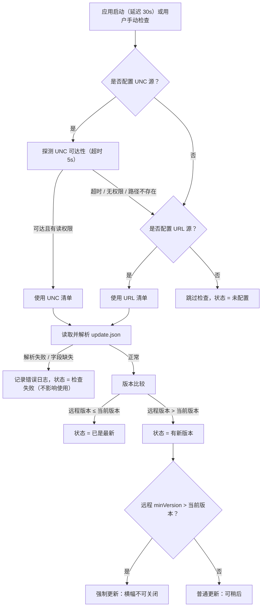
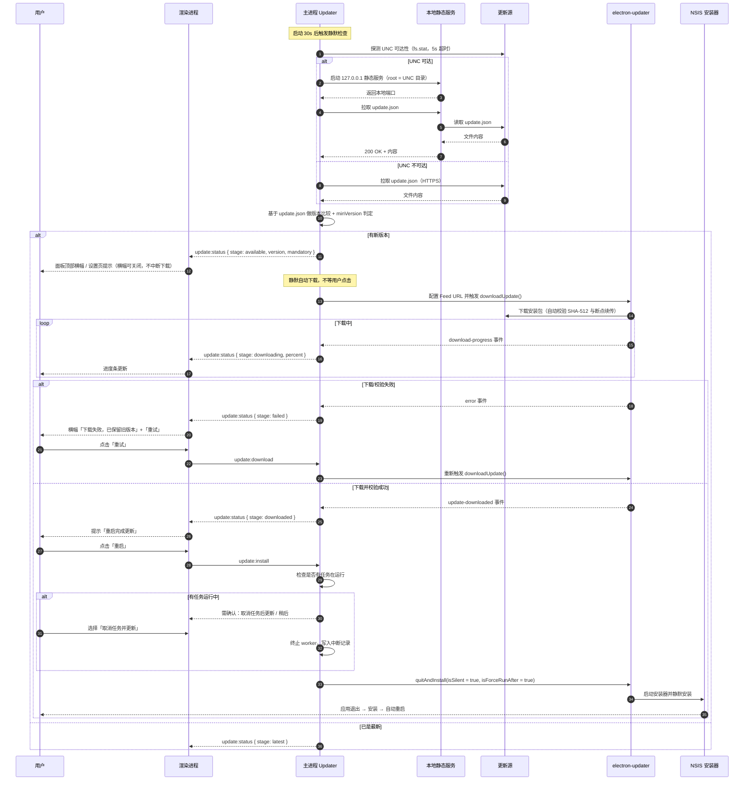
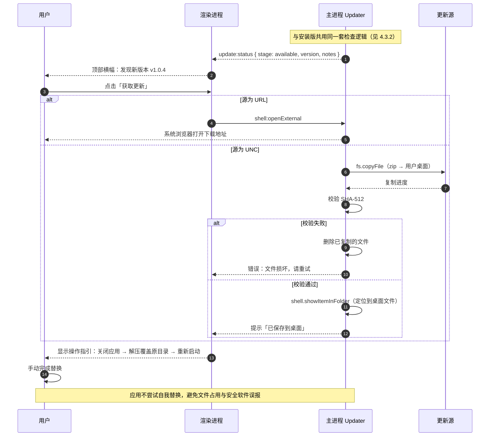

# shx-tools 需求与方案设计（总览）

> 版本：v1.3（2026-10-25；v1.0 评审通过后修订 D16 与 EL 接入方式） ｜ 日期：2026-10-25 ｜ 状态：方案已细化，待移交实现

---

## 0. 结论摘要

`shx-tools` 定位为**内部自动化工具箱**：一个可扩展的桌面容器，把零散的重复劳动收敛为"选择工具 → 填参数 → 跑任务 → 看结果"的统一体验。

三条核心设计判断：

1. **平台骨架以"任务"为中心，不以"工具"为中心。** 所有工具共享任务调度、进度上报、日志、结果报告，新工具接入只需实现一个执行器。
2. **重活全部离开渲染进程。** 目录扫描、文件复制运行在 `utilityProcess`，UI 永不阻塞，任务可取消。
3. **两种分发形态，两套更新策略。** 安装版走 NSIS 全自动更新；免安装版走"检查 + 提示下载"，因为官方更新组件不支持免安装形态。

首个版本（MVP）聚焦交付 F1 图片收集工具，骨架按第 3 个、第 10 个工具来设计。

### 0.1 已确认前提（2026-10-23 对齐）

| 项        | 结论                          | 对方案的影响                                   |
| -------- | --------------------------- | ---------------------------------------- |
| 终端系统     | 仅 Win10/11，x64              | 可使用最新技术栈，无需兼容 Win7 与 32 位                |
| Electron | 44.9.x                      | 锁版本，1~2 个月后评估升级 45                       |
| 代码签名     | 无证书，且无法申请                   | 安装包必然触发 SmartScreen，分发策略需适配（见 4.2）       |
| 更新源      | UNC 共享 + HTTPS 双源，**本地可配置** | 两个源均为设置页字段，保存即生效；UNC 优先，不可达回退 HTTPS；均可留空 |
| 免安装版更新   | 仅"检查 + 提示下载"                | 不做启动器与版本切换，工作量大幅下降                       |
| 图片源路径    | 本地与 UNC 都有                  | 扫描器自动识别路径类型并切换并发                         |
| 单次任务规模   | 百级目录、千级文件                   | 全量内存处理，无需分批落盘；组合数上千时列表截断渲染               |
| 人力       | 1 人全职                       | 排期按单人估算，范围必须收敛                           |
| 交付节奏     | 聚焦交付 F1                     | 见第 6 节排期                                 |

### 0.2 文档结构

本项目方案按职责分离，避免单文件膨胀到无法维护：

| 文档              | 内容                                                                     | 读者        |
| --------------- | ---------------------------------------------------------------------- | --------- |
| **本文（总览）**      | 产品定位、平台能力、非功能要求、关键技术方案（表单、打包、更新、安全、日志）、里程碑、风险、决策记录                     | 所有人；先读这份  |
| **《架构设计与技术栈》**  | 进程模型、分层与依赖规则、模块划分、任务数据流、工具契约、状态机、通信协议、IPC、存储、错误模型、并发控制、技术选型、工程结构、项目初始化 | 开发        |
| **《F1 图片收集设计》** | F1 的完整需求规格、`.lnk` 解析、路径模板、笛卡尔积扫描、异常矩阵、测试要点                             | 负责 F1 的开发 |
| **《UI 设计规范》**    | 导航与布局、关键流程、逐页规格、状态矩阵、组件用法边界、设计令牌、文案规范、可访问性、验收清单                                  | 前端；评审 |

**阅读顺序建议**：总览 → 架构 → F1 独立文档 → UI 规范（动手写界面前必读）。决策以总览第 8 节为准，细节冲突时以独立文档为准。

---

## 1. 产品定位与范围

### 1.1 要解决的问题

内部存在大量"打开某个目录 → 按规则挑文件 → 复制/整理"的重复劳动。现状是每人一套手工流程或一次性脚本，口径不一致、结果不可追溯、换人就得重来。

`shx-tools` 提供：统一的参数入口、可复用的规则模板、可追溯的执行记录。

### 1.2 用户

| 角色       | 诉求                      |
| -------- | ----------------------- |
| 普通使用者    | 打开就会用，不需要懂深层路径语法和编写复杂脚本 |
| 规则维护者    | 把口径固化成模板，分发给同事          |
| 平台维护者（你） | 低成本接入新工具，能定位线上问题        |

### 1.3 术语

| 术语        | 含义                                                             |
| --------- | -------------------------------------------------------------- |
| 产品        | 一条产线产品，对应一个入口目录（`力禧特`、`利珀`、`EL`）                               |
| 入口        | 用户选择的根目录。形态 A 下其一级子目录是区域；形态 B 下其一级子目录就是机台                      |
| 入口形态      | **形态 A（快捷方式）** 与 **形态 B（直连目录）**，由入口结构自动判定，决定机台的发现方式            |
| 区域        | `东区` / `西区`，同一任务内**互斥**。形态 A 是真实目录，形态 B 由机台名首字母推导              |
| 机台        | 产线设备。形态 A 下是 `.lnk` 快捷方式（文件名即编号，目标路径藏在二进制里）；形态 B 下是真实目录，目录名即编号 |
| 缺陷 / 不良类型 | 图片目录名，表示该批图片的缺陷分类，如 `明暗片`、`NG_连续性断栅_A-`                        |
| 等级        | 利珀的图片格式分类：A 无损 / B 有损 / C 特定格式，固定全收                            |
| 时段        | 小时目录，取值随班次（白班 8~~19 / 夜班 20~~23+0~7，利珀两位补零）                    |
| 组合        | 笛卡尔积展开出的一条待扫描目录，是扫描与统计的最小单位                                    |

### 1.4 明确不做（本期）

- 不做多用户/账号体系，不做服务端，不做数据上传
- 不做插件市场与在线安装第三方工具（工具随包内置）
- 不做定时/后台自动执行（后续可加，架构已预留）
- 不做云端任务队列与结果共享

---

## 2. 需求规格

### 2.1 F1 图片批量收集

从**产品入口**出发，按入口形态分两条发现路径：

- **形态 A（利珀、力禧特）**：一级子目录是**区域**（东区/西区，互斥），区域内的 `.lnk` 是**机台**，解析二进制得到 UNC 根
- **形态 B（EL）**：入口下的一级子目录直接就是**机台**（`B04-A`、`A05-A`），机台根 = 入口 + 目录名，区域由机台名首字母推导（`A` 东区 / `B` 西区）

拿到机台后，再按 **机台 + 日期 + 班次 + 时段 + 不良类型** 精确构造目标目录，只扫这些目录收集图片。

几个关键点：

- 形态 A 的机台是**快捷方式文件**，需用纯 Node 解析 Shell Link 二进制格式取目标路径
- 形态 B 的机台是**真实目录**，路径直接拼接，不解析任何二进制
- 三类产品路径规则差异很大（利珀有 `Matting`、等级 A/B/C；力禧特有固定工位 `A-01-B`、日期无分隔；EL 的机台名直接嵌在路径第 4 段），用**可配置模板**渲染，不硬编码
- EL 的入口通过 Windows「网络位置」添加，**本质仍是 UNC**（`\\10.108.164.2\qj-dc-el\DC`），不映射盘符；工具对 UNC 原样使用、不做还原。若用户手工输入盘符路径，按盘符处理并提示改用 UNC
- 每个字段都是**集合**，按笛卡尔积展开成待扫描目录（3 机台 × 10 小时 × 2 缺陷 × 3 等级 = 180 个），逐个扫描并按状态归类：有图片 / 空目录 / 不存在 / 不可达 / 无权限
- **扫描任务的对象是目录**：参数展开成一份固定的目录列表（长度 N 与磁盘状态无关，3 机台 × 10 小时 × 2 缺陷 × 3 等级 = 180 项），任务就是逐项判定状态；不可达/不存在是**某一项的状态**，不是「少扫一项」，列表不会变短
- **作业拆成两次任务**：先跑**扫描任务**（只读，产出目录状态 + 文件清单，可单独重跑），看清结果后再跑**复制任务**（消费清单，写目标盘）。扫描不写任何文件，所以空间预检才准、参数错了也不产生垃圾；清单落盘后可被多次复制复用

完整需求规格、`.lnk` 解析方案、路径模板与技术实现见独立文档 **《shx-tools F1 图片收集设计》**。

---

### 2.2 平台能力

| 编号 | 能力   | 要求                                                             |
| -- | ---- | -------------------------------------------------------------- |
| P1 | 工具入口 | **左侧栏一级入口**，由工具清单自动生成；启动直达上次页面，不设首页；新增工具即多一行，不改导航代码 |
| P2 | 任务记录 | **扫描与复制两类任务**分别记录，均落盘为本地 JSON（一个任务一个文件，各保留最近 200 条）；运行中 / 已完成 / 失败 / 已取消 四态（异常退出另记为「中断」）；任务中心支持搜索、只看失败与删除单条终态记录；实时进度、日志流；可取消 |
| P3 | 参数模板 | 每个工具的可保存配置，支持命名、复制、删除、导入导出                                     |
| P4 | 结果查看 | 展示摘要与失败明细，一键打开输出目录，导出 CSV                                      |
| P5 | 设置   | 默认输出目录、并发数、日志级别、更新源（UNC / HTTPS 双源，本地可配，见 4.3.1）、检查更新、打开日志目录   |
| P6 | 诊断   | 一键导出诊断包（版本、系统信息、最近日志、脱敏后的配置）                                   |

### 2.3 非功能需求

| 维度    | 指标                                                          |
| ----- | ----------------------------------------------------------- |
| 启动    | 冷启动到可交互 < 3 秒（SSD）                                          |
| UI 响应 | 任何操作反馈 < 100 ms；重任务不得阻塞主线程超过 50 ms                          |
| 内存    | 空闲 < 300 MB；批量任务峰值 < 1.5 GB                                 |
| 兼容    | Windows 10 1809+ / Windows 11，x64；开发环境 macOS（arm64/x64）     |
| 离线    | 全功能离线可用，更新检查失败不影响使用                                         |
| 安全    | `contextIsolation` 开、`nodeIntegration` 关、`sandbox` 开、CSP 限制 |
| 可维护   | 新增一个工具 ≤ 1 天工作量，不改动框架代码                                     |

---

## 3. 架构概览

三句话概括：

- **三个进程**：主进程负责编排与状态，渲染进程只做界面，`utilityProcess` 承载所有重任务，崩溃互不影响。
- **四层依赖**：`shared` ← `infra` ← `tools` ← `worker`，加上 `core`/`ipc`/`preload`/`ui` 的编排链路。依赖方向单向，越层由 ESLint 拦截。
- **一个契约**：工具实现 `ToolExecutor`（`scan` + `copy` 两个可选方法），任务由 `TaskManager` 统一调度、持久化、广播。

```
Main(编排/状态/IPC/更新)  ──fork──▶  Worker(工具执行器)
   │                                    │
   └──IPC──▶ Renderer(UI)               └──▶ infra(fs / lnk / 并发)
              ▲
          Preload(白名单)
```

进程模型、分层规则、模块划分、任务数据流、工具契约、状态机、Worker 协议、IPC 契约、存储布局、错误模型、并发控制，全部见 **《shx-tools 架构设计与技术栈》第 1~12 章**。

---

## 4. 关键技术方案

### 4.1 动态表单

`paramsSchema` 用 JSON Schema 描述，前端用统一渲染器映射到 antd 组件：

| schema                           | 组件                          |
| -------------------------------- | --------------------------- |
| `string` + `format: path`        | 目录选择器（调 `fs:pickDirectory`） |
| `string` + `format: file-list`   | 文件多选（支持拖拽）                  |
| `string` + `enum`                | Select                      |
| `number` / `integer` + `minimum` | InputNumber                 |
| `boolean`                        | Switch                      |
| `array` + `items.enum`           | Checkbox.Group              |
| `object` + `ui:group`            | 折叠面板分组                      |

F1 的交互特性（机台勾选联动、时段与班次联动）采用自定义表单（`ui: 'custom'`），`paramsSchema` 仍保留用于校验与模板兼容。**不追求 100% 自动生成**，那会牺牲体验。

### 4.2 打包与分发

| 形态   | 目标     | 产物                            | 适用场景           |
| ---- | ------ | ----------------------------- | -------------- |
| 安装版  | `nsis` | `shx-tools-Setup-1.0.0.exe`   | 大多数同事，可自动更新    |
| 免安装版 | `zip`  | `shx-tools-1.0.0-win-x64.zip` | 无管理员权限、软件白名单环境 |

- 打包参数（NSIS 安装向导选项、`asar`、`asarUnpack`）的完整取值见《架构设计与技术栈》14.5，本节只讨论分发决策
- **代码签名（已确认无证书且无法申请）**：安装包与 exe 首次运行必然触发 SmartScreen「未知发布者」提示。应对措施：
  1. 优先推免安装 ZIP：解压后右键「属性 → 解除锁定」可去掉"来自网络"标记；若走公司软件中心 / SCCM / 组策略推送，可绕过用户手动确认
  2. 域环境可自签名 + 导入受信任根，但需管理员权限且逐台导入，仅作备选
  3. 随包附 SHA-256 校验值与图文安装指引，降低同事的心理门槛
  4. 保持 NSIS 卸载信息完整、安装包命名规范，减少安全软件误判
- macOS 仅用于开发调试，不产出分发物（无签名/公证成本不划算）


### 4.3 自动更新（双通道）

**核心事实**：`electron-updater` 官方只支持 NSIS / DMG / AppImage 等目标，**ZIP 与 portable 不生成 `latest.yml`，无法走官方更新链路**。因此两种形态必须分开设计。

#### 4.3.1 更新源配置（本地可配）

更新源不硬编码、不打进安装包，全部通过本地配置决定，改完即生效。

**配置项**（设置页「更新」分组）

| 配置项       | 类型     | 校验规则                                                                   | 默认  |
| --------- | ------ | ---------------------------------------------------------------------- | --- |
| 启用自动检查    | 开关     | —                                                                      | 开   |
| UNC 更新源   | 文本     | 以 `\\` 开头，形如 `\\server\share\path`；也接受已映射的盘符路径 `Z:\tools\...`；留空 = 不启用 | 空   |
| HTTPS 更新源 | 文本     | 必须以 `https://` 开头，允许自定义端口与子路径；**拒绝 `http://`**；留空 = 不启用                | 空   |
| 检查时机      | 单选     | 启动时 / 每日一次 / 每周一次 / 仅手动                                                | 启动时 |
| 允许自签证书    | 开关（高级） | 仅内部 HTTPS 使用自签证书时开启                                                    | 关   |

**优先级**：UNC 优先 → HTTPS 回退。两者都填时，每次检查先探 UNC（5 秒超时），不可达或清单读取失败才走 HTTPS；两者都空时状态为「未配置」，静默跳过，不报错。

**生效时机**：保存即生效，无需重启。切换源不清空已下载的更新包，但会重新核对校验值。

**测试连接**（每个源后置一个「测试」按钮）

| 源类型   | 探测方式                       | 成功反馈               | 失败反馈                         |
| ----- | -------------------------- | ------------------ | ---------------------------- |
| UNC   | `fs.stat(<源>/update.json)` | 耗时 + 文件大小 + 清单版本号  | 路径不存在 / 无访问权限 / 超时（>5s）      |
| HTTPS | `HEAD <源>/update.json`     | 状态码 + 证书主体 + 清单版本号 | 404 / 证书不受信任 / TLS 握手失败 / 超时 |

失败时给具体原因，不给"连接失败"这种无从下手的提示。证书错误时附一句"若为内部自签证书，可在高级设置中允许"。

**配置文件**（`%APPDATA%/shx-tools/config.json`）

```json
{
  "update": {
    "enabled": true,
    "uncSource": "\\\\fileserver\\tools\\shx-tools\\releases",
    "httpsSource": "https://tools.example.com/shx-tools/releases",
    "checkTiming": "startup",
    "allowSelfSignedCert": false,
    "locked": false
  },
  "ui": {
    "lastRoute": "#/tools/image-collector",
    "sidebarCollapsed": false,
    "window": { "width": 1280, "height": 840, "maximized": false }
  }
}
```

`ui` 段只放跨会话要记住的界面状态（启动恢复、侧栏折叠、窗口尺寸），业务数据不进 `config.json`——完整存储布局见《架构设计与技术栈》第 10 章。

**默认值注入**：构建时通过环境变量生成 `build-config.json` 一并打包；首次启动合并进用户配置，之后不再覆盖。这样升级安装包不会重置用户已经改过的源。

**锁定模式（locked）**：打包时可选开启。开启后两个源字段在界面上只读置灰，值只能来自安装包携带的 `build-config.json`。用途是统一管控更新通道，防止有人把源改成外网地址。默认关闭——内部工具更需要"源挂了能当场改"的自救能力。

**发布产物清单**（同一份版本元数据生成，避免两处不一致）

| 文件            | 使用方                   | 说明                         |
| ------------- | --------------------- | -------------------------- |
| `latest.yml`  | 安装版（electron-updater） | 由 electron-builder 生成，不能手改 |
| `update.json` | 免安装版 + 人工核对 + 源健康探针   | 自研格式，见下文「更新清单格式」           |

**安全约束**

- HTTPS 源强制 TLS，不接受明文 `http://`，避免更新包在传输中被替换
- 自签证书必须显式开启，开启后在设置页常驻一条警示文字
- 无论源是否可信，更新包一律校验 SHA-512，校验失败即删除
- 源地址变更写入日志（旧值、新值、时间、操作来源），排查"为什么没更新"时这是第一手证据

**通道 A：安装版（NSIS）**

- 用 `electron-updater`，provider 设为 `generic`，feed URL 由 4.3.1 的配置推导
- UNC 源的处理：主进程启动时拉起一个极简静态 HTTP 服务（`node:http`，监听 `127.0.0.1` 随机端口，根目录指向 UNC 路径，仅允许 `latest.yml` 与 `*.exe`），把该本地地址作为 feed URL 交给 updater
- 这样做的原因：updater 的下载器只认 HTTP(S)，不能直接读 `file://` 或 UNC；用本地回环代理是最小改动的解法，且顺带解决了 UNC 需要凭据透传的问题
- 流程：启动后 30 秒静默检查 → 有更新则后台下载 → 下载完成提示"重启以更新" → `quitAndInstall`
- 支持 `minVersion`：低于该版本强制更新，不可跳过

**通道 B：免安装版（ZIP）—— 只做「检查 + 提示下载」**

已确认不做版本并存与自动替换，逻辑收敛为四步：

1. 启动后按同一清单源（UNC 优先、URL 回退）检查版本
2. 有新版本时，在面板顶部横幅与设置页提示版本号与更新说明
3. 「下载」按钮：URL 源走 `shell.openExternal` 打开下载地址；UNC 源用 `fs.copyFile` 把 zip 复制到用户桌面并 `shell.showItemInFolder` 定位
4. 提示"关闭应用后解压覆盖原目录"，附一句注意事项即可

**为什么不自动替换**：ZIP 形态下应用无法安全替换正在运行的自身 exe。绕过方式（外部脚本延时覆盖）容易触发安全软件，在无代码签名的前提下误报概率进一步放大；启动器的回滚、断电、半包等异常路径，单人维护成本也不划算。等真有人抱怨"每次都要手动下"再升级。

保留的演进路径见附录 A。

**更新清单格式（自研部分统一）**

```json
{
  "version": "1.0.3",
  "minVersion": "1.0.0",
  "releaseDate": "2026-10-23",
  "notes": "修复 UNC 路径扫描卡顿",
  "mandatory": false,
  "nsis": { "file": "shx-tools-Setup-1.0.3.exe", "sha512": "...", "size": 89234123 },
  "zip":  { "file": "shx-tools-1.0.3-win-x64.zip", "sha512": "...", "size": 94120334 }
}
```

#### 4.3.2 源选择与降级



**降级原则**：任一源失败都不阻塞应用启动，也不弹错误弹窗，只在设置页留一行状态文字。内部工具的更新失败不值得打断用户手上正在做的事。

#### 4.3.3 安装版（NSIS）更新时序



#### 4.3.4 免安装版（ZIP）更新时序



#### 4.3.5 异常路径矩阵

| 异常场景             | 检测点                    | 处理策略                       | 用户可见反馈                    |
| ---------------- | ---------------------- | -------------------------- | ------------------------- |
| UNC 不可达 / 无权限    | 检查前 `fs.stat` 探测，5s 超时 | 回退 URL 源                   | 仅设置页显示"UNC 不可达，已切换备用源"    |
| 两个源都失败           | 源选择结束                  | 放弃本次检查，写日志                 | 设置页一行灰字"检查失败，可稍后重试"，不弹窗   |
| 清单 JSON 损坏 / 缺字段 | 解析后 zod 校验             | 丢弃本次结果                     | 同"检查失败"，日志记录具体字段          |
| 版本号格式非法          | 版本比较前                  | 跳过该版本                      | 视为检查失败，不提示更新              |
| 低于 minVersion    | 版本比较后                  | 强制更新，横幅不可关闭                | 全屏遮罩 + "必须更新后才能继续使用"      |
| 磁盘空间不足           | 下载前预检                  | 不开始下载                      | "需要 120 MB 空间，当前可用 80 MB" |
| 下载中断             | 传输层异常                  | HTTP 走 Range 续传，UNC 重试 2 次 | 进度条显示"重试中 (1/2)"          |
| 包校验失败            | SHA-512 比对             | 删除临时文件，终止                  | "安装包校验失败，已删除，请重新下载"       |
| 安装时任务仍在运行        | `quitAndInstall` 前     | 询问用户，确认后终止 worker          | 二选一弹窗，默认"稍后"              |
| 安装程序被杀软拦截        | 无法主动检测                 | 启动后比对版本号                   | 若版本未变，提示"更新未生效，请手动下载安装"   |
| 用户拒绝重启           | 提示后                    | 下次启动再提示，累计 3 次后强提示         | 横幅常驻，不再弹窗                 |
| 便携版替换时文件被占用      | 用户操作阶段                 | 无法检测                       | 指引中明确"请先完全退出应用"           |
| 系统时间异常导致版本误判     | 版本比较仅用语义化版本号，不依赖时间     | 不受影响                       | —                         |

> 设计原则：**更新失败永远不能影响应用可用性**。除"低于 minVersion"外，所有异常都不阻断主流程；除"强制更新"外，所有提示都可关闭。

### 4.4 安全基线

```ts
new BrowserWindow({
  webPreferences: {
    preload: path.join(__dirname, 'preload.js'),
    contextIsolation: true,
    nodeIntegration: false,
    sandbox: true,
    webSecurity: true,
  },
});
```

- preload 只暴露白名单方法，不透传 `ipcRenderer`
- 渲染进程所有入参在主进程用 zod 复核（路径、枚举、数值范围）
- 路径安全：只接受用户通过系统对话框选择的路径，或落在已授权根目录下的子路径；拒绝 `..` 穿越
- `setWindowOpenHandler` 一律 `deny`，外链走 `shell.openExternal` 且只允许 `https:`
- 禁用 `webview`，`will-navigate` 拦截外部导航
- 生产环境 CSP：`default-src 'self'; script-src 'self'; style-src 'self' 'unsafe-inline'`
- 更新包必须校验 SHA-512，校验失败删除并提示，不提供"忽略并继续"

### 4.5 日志与诊断

- 主进程与 worker 统一走一个 logger，写入按天滚动的文件，同时通过 IPC 推给 UI 的任务日志面板
- 日志分级：`debug / info / warn / error`，默认 `info`，设置里可切 `debug`
- 诊断包（P6）：打包 `config.json`（脱敏：路径只保留盘符层级）、最近 3 天日志、系统信息、已装工具版本，生成 zip 到桌面，便于同事反馈问题

---

## 5. 技术栈速览

| 层    | 选择                                                                 |
| ---- | ------------------------------------------------------------------ |
| 运行时  | Electron 44.9.x（Chromium 152 / Node 24），生产仅 Windows x64，开发兼顾 macOS |
| 前端   | React 19 + Ant Design 6.6.7 + React Router 7（Hash）+ Zustand        |
| 构建   | Vite 8 + electron-vite；main/preload 输出 CJS，renderer ESM            |
| 语言   | TypeScript 5.x（strict）                                             |
| 数据处理 | image-size（读文件头取尺寸）、zod（校验）                                        |
| 打包   | electron-builder 26：NSIS + ZIP 双目标                                 |
| 测试   | Vitest（单元/集成）+ Playwright（冒烟）                                      |

选型理由、替代方案对比、版本锁定策略见 **《shx-tools 架构设计与技术栈》第 13 章**；目录规划、构建与打包配置见第 14 章。

---

## 6. 里程碑

### 6.1 F1 交付排期（约 3.5 周）

| 阶段 | 内容                             | 预估  | 交付判据                                    |
| -- | ------------------------------ | --- | --------------------------------------- |
| M0 | 初始化与任务骨架                       | 3 天 | 打包后的 exe 能跑通假工具全流程（清单见《架构设计与技术栈》第 15 章） |
| M1 | F1：`.lnk` 解析、路径模板、笛卡尔积扫描、复制与报告（扫描/复制两个任务）；前缀预检（缺失前缀批量剪枝，UNC/本地均默认开启、无开关） | 8 天 | 真实入口跑通 180 个组合，六类状态分类准确；扫描产物可被复制任务复用；前缀预检不改变任何状态，仅降低空扫描耗时 |
| M2 | 模板管理、任务历史、设置                   | 2 天 | 规则可存成模板给同事复用                            |
| M3 | 打包 NSIS + ZIP、安装版自动更新          | 3 天 | 同事机器上装、升、回滚全通                           |
| M4 | 内测、打磨与修缺陷                      | 3 天 | 3 位同事独立完成真实任务；空态、错误文案与诊断包就绪             |

合计约 **3.5 周**。M0 验证任务骨架，M1 攻克核心收集功能，M2~M4 完善体验与交付。

---

## 7. 风险清单

| 编号 | 风险                     | 影响                                  | 对策                                                       |
| -- | ---------------------- | ----------------------------------- | -------------------------------------------------------- |
| R1 | 组合数膨胀，扫描时间不可控          | 用户填 5 机台 × 20 小时 × 5 缺陷，跑到一半才发现要一小时 | 组合数分级提示（500/5000/20000 三档）+ 前 20 个目录测速预估；随时可取消并按已完成部分出报告 |
| R2 | 免安装版仅提示下载，用户长期停在旧版     | 版本碎片，问题难以复现                         | 启动时展示版本横幅；诊断包携带版本号；关键修复用顶部公告强提示                          |
| R3 | 无代码签名证书，SmartScreen 拦截 | 同事不敢装，推广受阻                          | 优先推免安装 ZIP + 内部渠道分发；附 SHA-256 与图文指引；域环境可自签名导入受信任根        |
| R4 | Electron 45 过新，生态库兼容问题 | 构建/运行异常                             | 锁 44，等 antd/electron-builder 生态跟进再升                      |
| R5 | 同事把工具当"万能脚本"，提大量定制需求   | 范围失控                                | 参数模板机制吸收 80% 差异；剩余需求进 backlog 按频次排期                      |
| R6 | 长时间任务中途关机导致记录不一致       | 历史记录脏数据                             | 启动时扫描 `running` 状态任务，标记为 `interrupted` 并保留已完成计数          |

---

## 8. 决策记录

### 8.1 已确认

| 编号 | 决策点         | 结论                                                                                                          |
| -- | ----------- | ----------------------------------------------------------------------------------------------------------- |
| D1 | Electron 版本 | 44.9.x（8 个月后的 45 再评估）                                                                                       |
| D2 | 免安装版更新      | 只做检查 + 提示下载，不做启动器与自动替换                                                                                      |
| D3 | 更新源         | UNC 优先、URL 回退，双源可配                                                                                          |
| D4 | 代码签名        | 无证书且无法申请，按 4.2 的应对方案执行                                                                                      |
| D5 | 交付节奏        | 聚焦交付 F1                                                                                                     |
| D6 | 终端环境        | 仅 Win10/11 x64                                                                                              |
| D7 | 人力          | 1 人全职，范围按单人收敛                                                                                               |
| D8 | 项目初始化       | 用 `electron-vite` 官方脚手架起步，只取构建配置、示例代码全删。不用 Electron Forge（Squirrel 更新链路与 NSIS 冲突），不用社区 boilerplate（黑盒、升级滞后） |
| D9 | 构建工具        | electron-vite（Vite 8），main/preload 输出 CJS，renderer ESM                                                      |
| D10 | 任务拆分 | **扫描任务与复制任务是两个独立实体**，清单落盘传递；取消 `listOnly` 模式（等同于只建扫描任务）；`preview/confirm` 三个概念随之删除 |
| D11 | 扫描与复制衔接 | 扫描产出可复用的 `CopyPlan`（含相对落点），用户选目标、点「开始复制」才创建 `CopyTask`；同一份扫描可建多条复制任务 |
| D12 | 任务中心形态 | 保留一级入口但瘦身：单表 + 搜索 + 只看失败 + 删除单条，不做双组筛选与分页器；运行中进度只在工具页展示 |
| D13 | 列表渲染 | 目录与任务列表一律虚拟滚动，9,000 个目录不截断、不做分页器 |
| D14 | 缺陷扫描深度 | 缺陷目录即扫描终点，不递归；出现子层级需改模板与扫描器，不靠扫描器顺手递归 |
| D15 | 持久化 | **暂不引入本地数据库**：任务记录一任务一 JSON、明细用 JSONL；M0 仅验证 SQLite 打包可行性作风险前置，不接入。按触发条件（任务 >2,000 条、明细 >300MB、跨扫描查询/聚合、多写进程等）再评估迁移 |
| D16 | 前缀预检（必做） | 按模板 `probePattern` 分组探测，只把 `missing` / `unreachable` / 空目录传播给整组；`denied` 与异常仍逐叶探测。UNC 与本地**均默认开启、不提供开关**；只到班次一级，不做时段级预检（2026-10-25 定）；状态分布必须与逐叶扫描逐项一致 |

### 8.2 仍待补充（不阻塞 M0）

| 编号 | 事项                  | 何时需要 | 未提供时的默认处理                |
| -- | ------------------- | ---- | ------------------------ |
| Q1 | ~~是否启用强制更新~~ | 已确认（2026-10-25） | 不强制，仅横幅提示 |
| Q2 | 更新源具体地址（共享路径 / URL） | M3 前提供（2026-10-25 定） | 先用本地目录模拟更新链路 |
| Q3 | ~~是否需要多语言~~ | 已确认（2026-10-25） | 仅中文，文案集中管理 |

---

## 9. 移交清单

本文档的边界止于需求分析与方案设计，编码实施由开发方执行。移交时应确认以下事项：

| 交付物                                                                | 出处                    | 状态         |
| ------------------------------------------------------------------ | --------------------- | ---------- |
| 需求规格（含验收标准与边界）                                               | 本文第 2 节               | 已完成        |
| 架构设计（进程模型、分层与依赖规则、模块划分、任务数据流、工具契约、状态机、通信协议、IPC、存储、错误模型、并发控制） | 《架构设计与技术栈》第 2~12 章    | 已完成        |
| 关键技术方案（含选型理由与已知限制）                                           | 本文第 4 节 + 《架构》第 13 章  | 已完成        |
| 工程结构（目录规划、构建与打包配置、编码约定、测试策略、质量门禁）                            | 《架构设计与技术栈》第 14 章      | 已完成        |
| 界面设计（导航结构、页面规格、状态矩阵、组件边界、设计令牌、文案规范、可访问性、验收清单）                        | 《UI 设计规范》             | 已完成（v1.0，2026-10-25 评审通过）        |
| F1 业务设计（`.lnk` 解析、路径模板、笛卡尔积、异常矩阵、测试要点）                             | 《F1 图片收集设计》           | 已完成        |
| 排期、风险与决策记录（第 6~8 节）                                                | 本文                    | 已完成        |
| 交互原型 / 高保真视觉稿                                                      | —                     | 未包含（UI 规范给的是约束，不是像素稿） |
| 更新源实际地址                                                            | —                     | M3 前提供，先用本地 mock    |

实施顺序按第 6 节推进。M0 阶段建议先用假工具验证「启动 → 进度 → 完成 → 报告」的任务链路，再填入真实业务逻辑。

---

## 附录 A：免安装版更新演进路径（暂不实施）

若后续要对 ZIP 版本做自动更新，推荐「版本目录 + 启动器切换」：

```
shx-tools/
├─ shx-tools.exe          # 启动器（约 2 MB，长期稳定，极少更新）
├─ current.json           # { "version": "1.0.3", "previous": "1.0.2" }
├─ versions/1.0.3/        # 完整应用
└─ downloads/             # 更新包缓存
```

启动器读 `current.json` 拉起对应版本；下载 → 校验 SHA-512 → 解压到 `versions/<new>/` → 原子写 `current.json` → 重启；新版本连续启动失败 2 次自动回滚到 `previous`。启动器本身需保持极简，因为它无法自我更新。
